<div align="center">

# Mechatronic Pinball Machine

A fully functional pinball machine designed and built from scratch by two students in 13 weeks:
3D-printed mechanisms, a laser-cut playfield, solenoid-driven actuators, sensors and Arduino game logic.

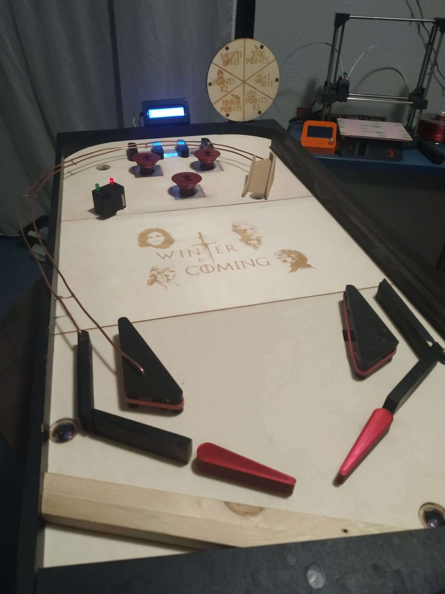

**About 600 hours of work** · **25+ parts designed in 3D** · **About €265 in materials**, compared with around €10,000 for a new pinball machine on the market

[Video presentation](https://youtu.be/dcDQBHgphmI) ·
[Final report](docs/final-report.pdf) ·
[Lab reports](docs/lab-reports/) ·
[Game firmware](firmware/pinball_game/pinball_game.ino)

</div>

---

## At a glance

| | |
|---|---|
| **Goal** | Show that a real pinball machine can be built from affordable, off-the-shelf components |
| **Mechanics** | Flippers, bumpers, slingshots, targets, plunger and ball return, all designed in 3D and prototyped on test boards |
| **Fabrication** | 3D printing (PLA), laser cutting and engraving of the playfield and borders |
| **Electronics** | Arduino Mega, 24V solenoids switched by relays, 24V → 5V step-down converter, infrared sensors, microswitches |
| **Game logic** | Near-real-time, non-blocking Arduino firmware for scoring, automatic ball return, an I2C LCD scoreboard and a NeoPixel wheel of fortune |
| **Context** | Robotics course, 2nd year of the integrated preparatory program at Polytech Nice-Sophia, 2022–2023 |

## Mechanisms designed from scratch

The mechanics of a commercial pinball machine are too complex and expensive to copy, so we designed every
mechanism ourselves and tested each one on a prototype board before the final version.

<div align="center">
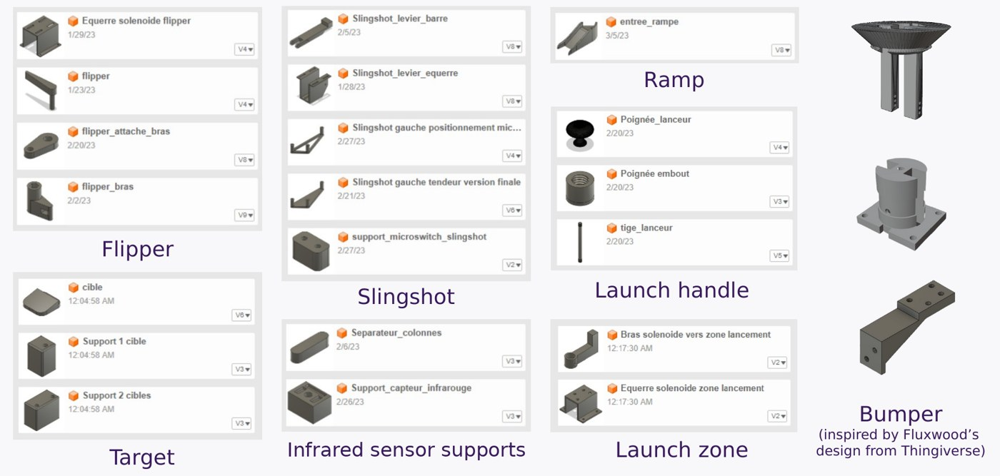
<br><sub>Mechanical parts designed by Adrien Waeles-Devaux in Fusion 360, grouped by subsystem</sub>
</div>

<table>
<tr>
<td align="center" width="25%">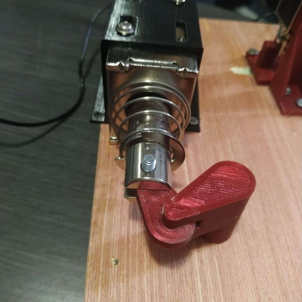<br><b>Flippers</b></td>
<td align="center" width="25%">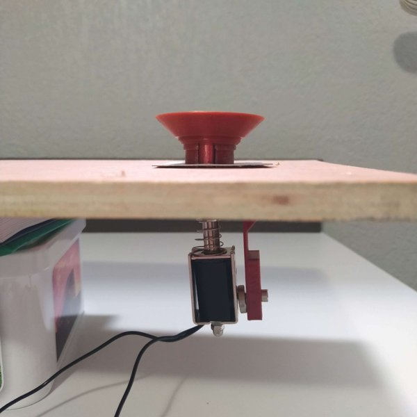<br><b>Bumpers</b></td>
<td align="center" width="25%">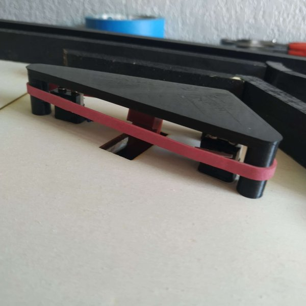<br><b>Slingshots</b></td>
<td align="center" width="25%">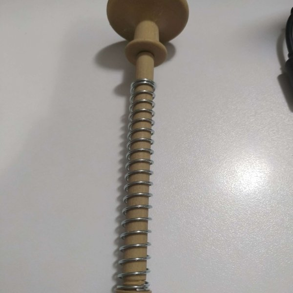<br><b>Plunger</b></td>
</tr>
</table>

- **Flippers:** a 3-part linkage converts the linear stroke of a 65 N solenoid into a rotation. The connecting part is
  printed *inside* the arm by pausing the 3D print, so it is trapped and rotates freely without any screw.
- **Bumpers:** adapted from an open-source design to fit our solenoids. The ball itself closes the circuit between a
  copper ring and a metal plate set into the playfield, which triggers the bumper.
- **Slingshots:** the first version did not hit the ball hard enough, so we redesigned it around a **lever** that
  increases both the range of motion and the force, after testing several pivot positions on a prototype.

  <table>
  <tr>
  <td align="center" width="33%">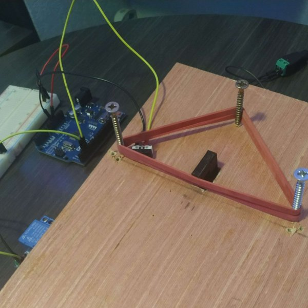<br><sub>1. First prototype</sub></td>
  <td align="center" width="33%">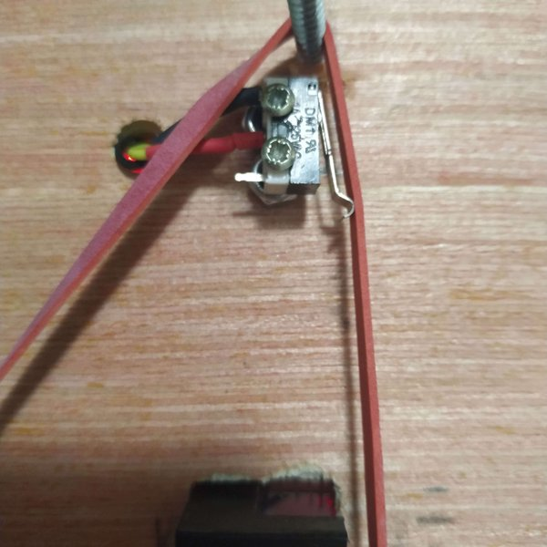<br><sub>2. Functional prototype</sub></td>
  <td align="center" width="33%"><br><sub>3. Final version</sub></td>
  </tr>
  </table>

- **Plunger:** printed in 3 threaded parts to avoid print supports and to fit through the border; they screw together
  without glue or screws.

## Design and fabrication

Before assembly, we modeled the whole machine in 3D with every part in place. This model gave the exact position of
each hole and component, so the playfield boards could be laser cut,
engraved and drilled with every hole already in place, saving a considerable amount of time. The
curved borders were converted from 3D models into 2D vector files for the laser cutter, and the infrared sensors sit
under clear acrylic inserts set flush with the playfield.

<table>
<tr>
<td>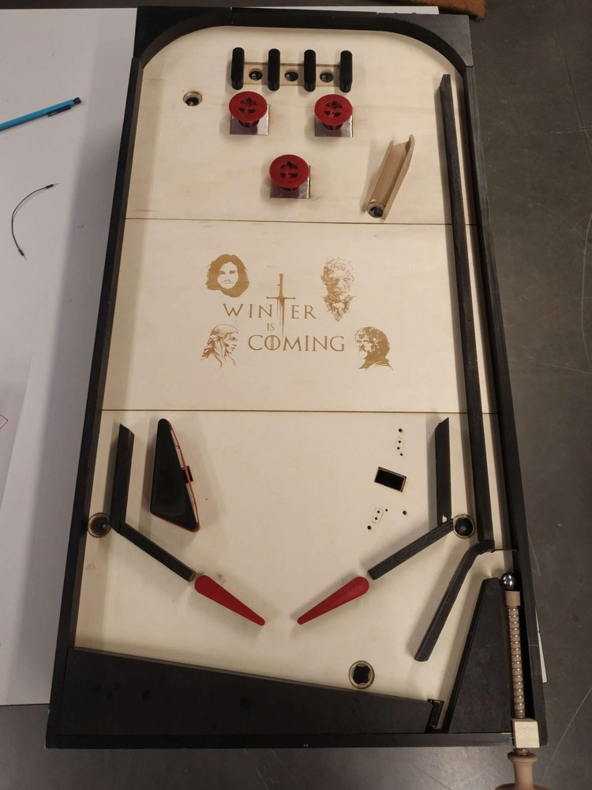</td>
<td>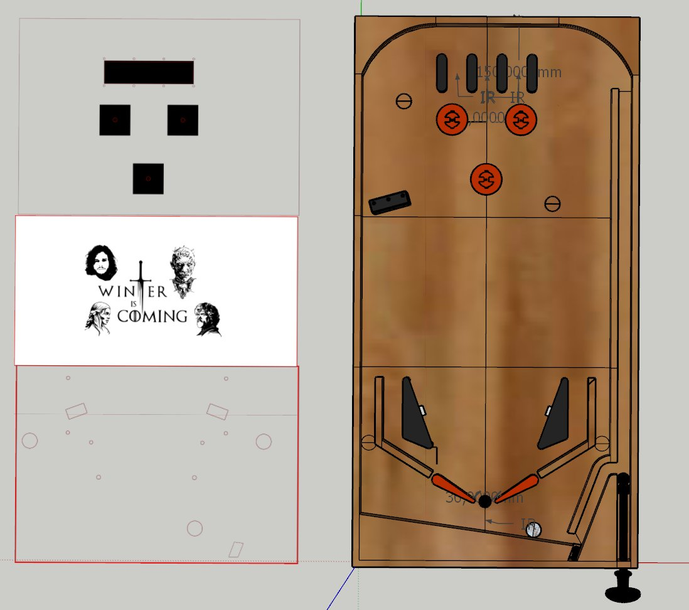</td>
</tr>
<tr>
<td align="center"><sub>The playfield during assembly</sub></td>
<td align="center"><sub>Full 3D model of the machine, used to cut and drill the boards</sub></td>
</tr>
</table>

## Electronics

- An **Arduino Mega** runs the game.
- **8 solenoids at 24V** (2 × 65 N for the flippers, 6 × 8 N for the bumpers, slingshots and ball return) are
  switched by **relay modules** and wired in parallel on a common ground.
- The flipper buttons drive their relays directly, so the flippers never wait for the microcontroller.
- A **step-down converter** turns the 24V supply into 5V for the Arduino, the sensors, the LCD and the NeoPixels.
- **8 infrared sensors** under clear acrylic inserts detect the ball; **microswitches** detect hits on the slingshots
  and targets.
- An **I2C module** drives the LCD with only 2 wires, to keep pins free for the many components.
- The **wheel of fortune** is made of 6 NeoPixels cut from a strip and re-soldered in a circle, controlled through
  a single data wire, with a buzzer.

The wiring diagram, drawn in Fritzing, is in [electronics/](electronics/).

<br clear="right">

## Firmware

The [game firmware](firmware/pinball_game/pinball_game.ino) handles scoring, the ball return, the LCD and the wheel
of fortune. It is **non-blocking**: it uses `millis()` timestamps instead of long delays, so the game keeps reacting
to the ball at all times, and it debounces the sensors so that a slow ball is counted only once. Each component was
first brought up with its own test sketch, in [firmware/bench_tests/](firmware/bench_tests/).

## Wheel of fortune

<table>
<tr>
<td width="50%">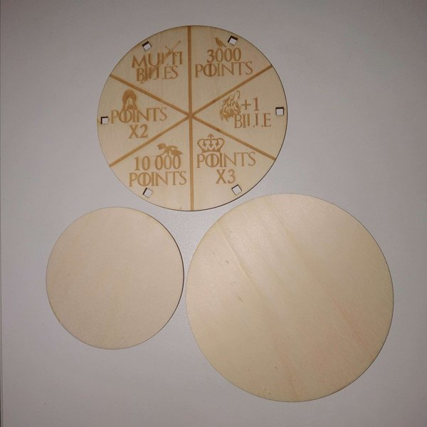</td>
<td width="50%">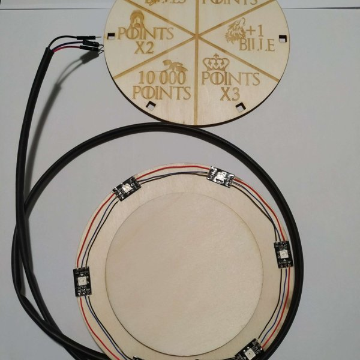</td>
</tr>
<tr>
<td align="center"><sub>Laser-cut and engraved wheel, designed in Blender</sub></td>
<td align="center"><sub>NeoPixels re-soldered in a circle behind the wheel</sub></td>
</tr>
</table>

An element of our own, not found on classic pinball machines. A light animation runs around the wheel with a beep at
each step, slows down, then stops and blinks on the bonus won.

## Gameplay

The player launches the ball with a spring-loaded plunger and keeps it in play with two flippers. The ball scores
points on the **bumpers**, the **targets** and the **lanes** at the top of the playfield, while the **slingshots**
kick it back into play, and the score is shown on an **LCD screen**. Above 3,000 points, the **wheel of fortune**
spins once per game and awards a random bonus: score multipliers, extra balls or bonus points. When the ball drains
between the flippers, an infrared sensor detects it and a solenoid sends it back to the launch lane. The playfield is
engraved with a *Game of Thrones* theme.

## Team

| Member | Role |
|---|---|
| **Adrien Waeles-Devaux** ([@AdrienWaeles](https://github.com/AdrienWaeles)) | 3D design of the mechanisms, 3D model of the machine, electronics and wiring diagram, wheel of fortune, Arduino firmware |
| **Redha Abderrahmane** ([@Redha-ABDERRAHMANE](https://github.com/Redha-ABDERRAHMANE)) | Laser cutting and engraving files, launch lane, electronics, assembly and wiring |

We documented every work session in [lab reports](docs/lab-reports/), with photos, videos and the problems we ran
into.

## Repository structure

```
├── docs/
│   ├── final-report.pdf          Project report: design, wiring, algorithm, costs
│   ├── project-specification.md  Initial specification
│   ├── component-list.md         Components and suppliers
│   ├── task-distribution.md      Plan of the 8 sessions
│   ├── french-version/           Original French documents
│   └── lab-reports/              Session reports by each team member
├── firmware/
│   ├── pinball_game/             Complete game (Arduino Mega)
│   └── bench_tests/              Test sketches for each component
├── mechanical/
│   ├── 3d-printing/              25 STL files
│   └── laser-cutting/            Playfield boards (SVG)
└── electronics/                  Wiring diagram (Fritzing)
```

## Acknowledgements

- **Polytech Nice-Sophia Fablab**, and Frédéric Juan for his help with the assembly
- The bumper parts are based on [this design by fluxwood](https://www.thingiverse.com/thing:3286052), and the
  flipper alignment shims on [thing:1644154](https://www.thingiverse.com/thing:1644154), both on Thingiverse
