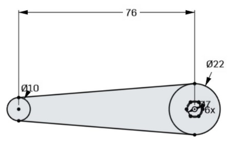
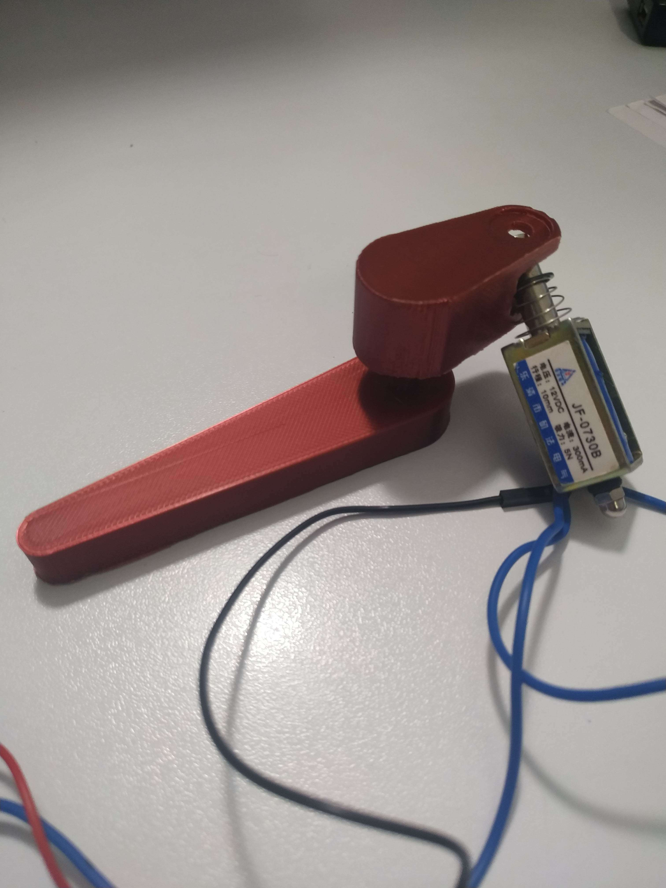
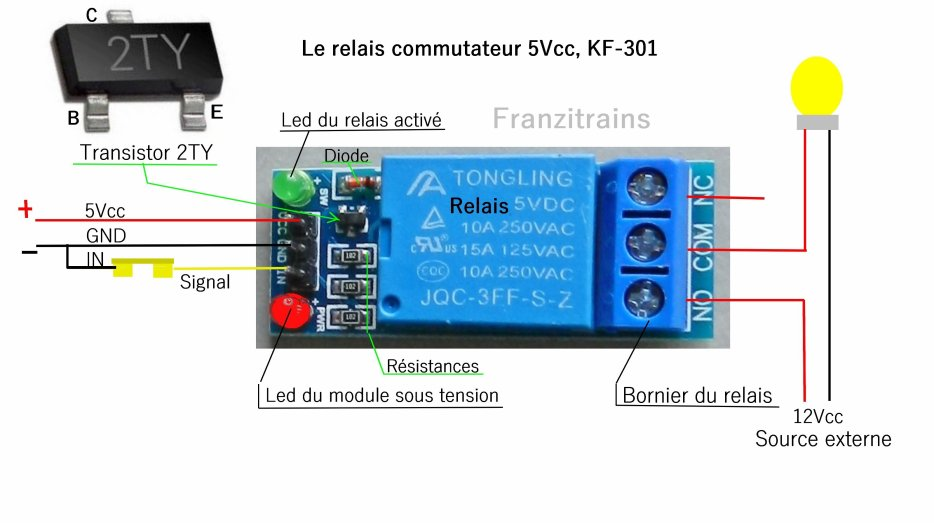
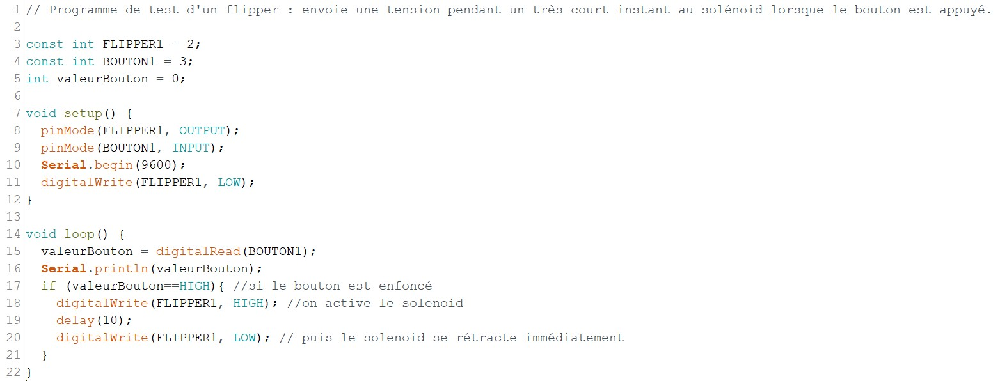
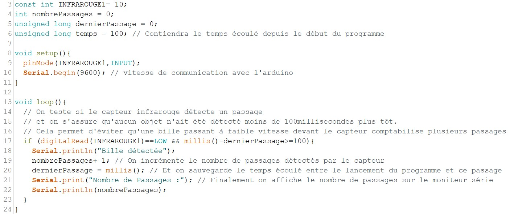

# Session 1

[🇫🇷 Version française](french-version/session-01.md)

Content of this session: 3D-printed flippers, testing a solenoid with a button, and detecting the ball with an infrared sensor.

## Before the session

We modeled two parts in 3D to build a flipper prototype, then I 3D-printed them so that we could run tests during the session and adapt the parts accordingly. The first part below is the left flipper, which sends the ball back up the board. The second part (the smaller one, which will be hidden under the board and attached to the motor) converts the linear motion of a solenoid into a rotation. The dimensions and shape of this last part will have to be adjusted soon to fit the chosen solenoid.

## During the session

Testing the JF-0730B solenoid (12V, 1A, 10mm stroke).
Since the solenoid must be powered with 12V, it needs an external power supply so as not to damage the Arduino board, so I added a switching relay to the circuit.
Datasheet of the JQC-3FF-S-Z switching relay:

The switching relay behaves like a switch controlled by the Arduino. When the switch is closed, the solenoid is powered by the external supply (here a 12V supply), and when the switch is open, the solenoid is no longer powered. To open or close the switch, the Arduino sends a digital signal. This also keeps the solenoid from overheating, since it is only powered while the button is pressed.

Here is the program:

Here is this first test in video:
https://www.youtube.com/watch?v=6iraHV_b1UE

Results of the tests and research: the small 12V solenoid does not seem strong enough to move the flippers with enough force, and the ball may not reach the top of the pinball machine.
A 24V solenoid seems ideal. However, this small solenoid can easily be used for the slingshots, which need less force.

Note: according to my research, each solenoid needs a diode, because when current is sent to the solenoid and then cut so that it returns to its initial position, the current may be sent back in the opposite direction, which disturbs the signals read by the Arduino and heats the solenoid even more. The diode built into the relay module only protects the relay's coil: the solenoid needs its own diode, connected in parallel across its terminals.

Finally, at the end of the session, I started thinking about how to use the infrared sensors. The infrared sensors will tell us where the ball went on the pinball machine; with this information we will be able to count points, trigger some motors or even turn on LEDs. The wiring is very simple: the sensor is connected to the Arduino's +5V and ground, and one last wire connects a digital pin of the Arduino to the sensor. For this project we only need to know whether a ball went past or not, so reading a digital signal is enough. I wrote this simple program to count the number of passes in front of a sensor:

I quickly realized that we cannot use the delay() function in our algorithm, because it would put the whole program on hold. Some elements, such as the flippers, must be usable by the player at any time and without latency. To solve this problem, I decided to use the millis() function, which returns the time elapsed in milliseconds since the program started. I store this time in a variable each time a pass is detected, and I can compare the time of the last pass with the current time. Before incrementing the number of passes, I check that the last detection of the infrared sensor happened more than 100 milliseconds ago, so that a ball moving slowly in front of the sensor is not counted several times.
