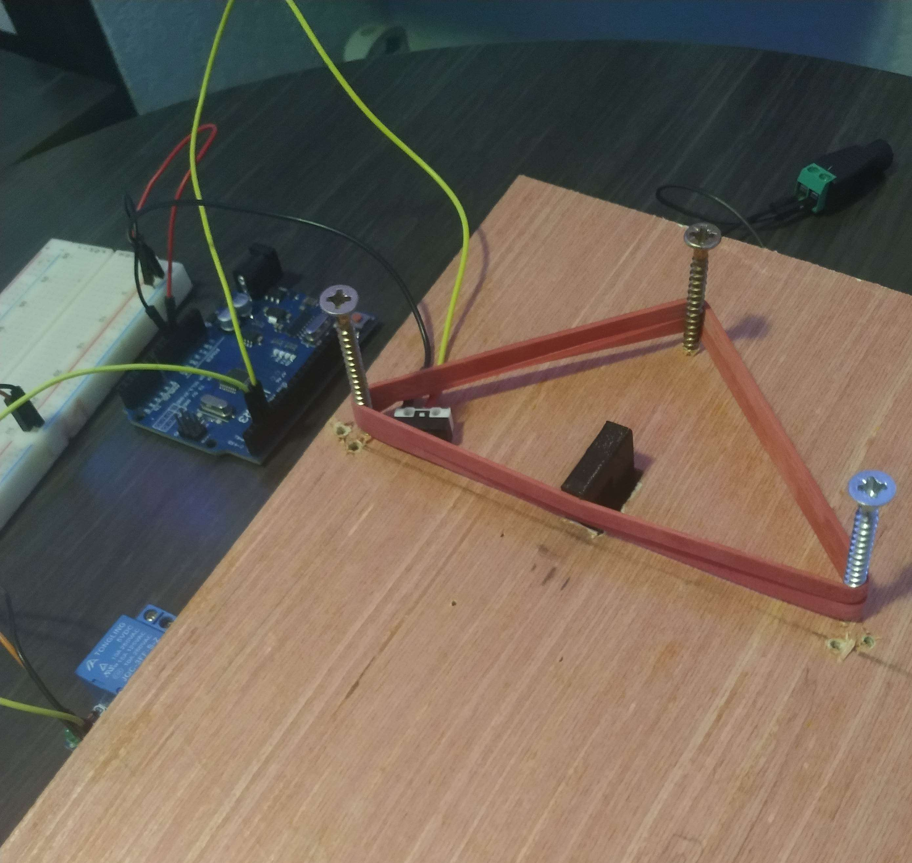
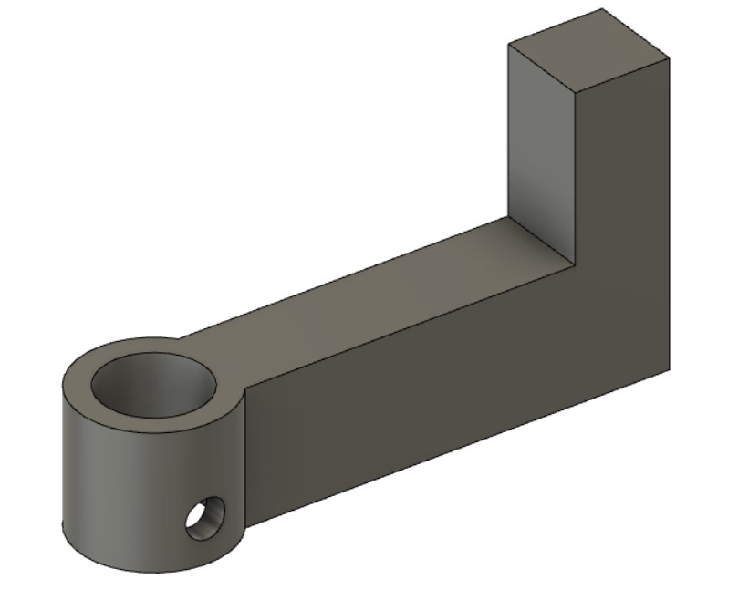
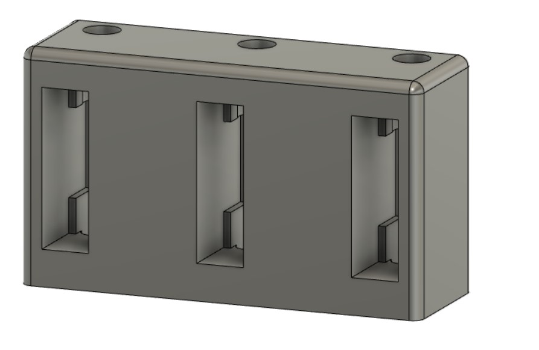
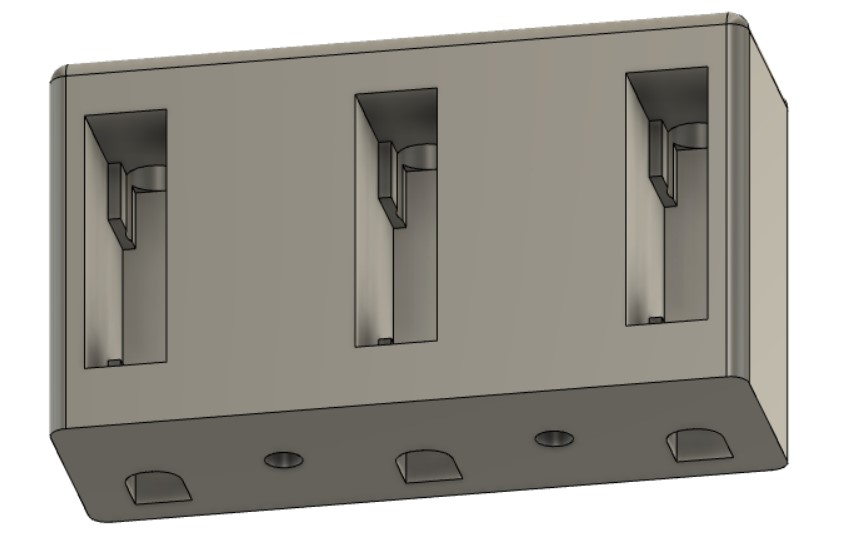
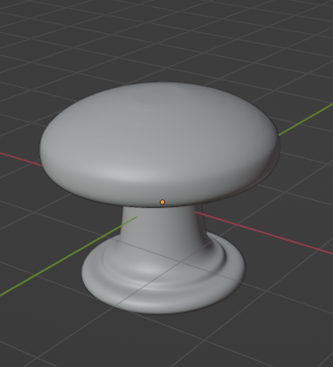
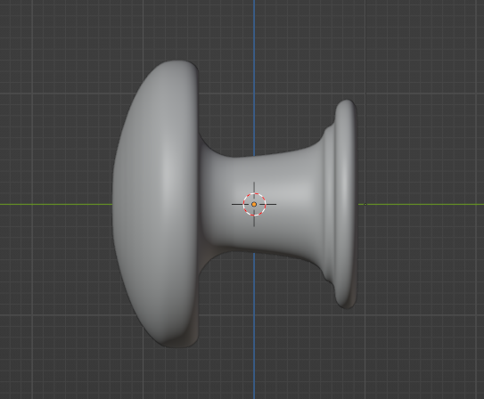
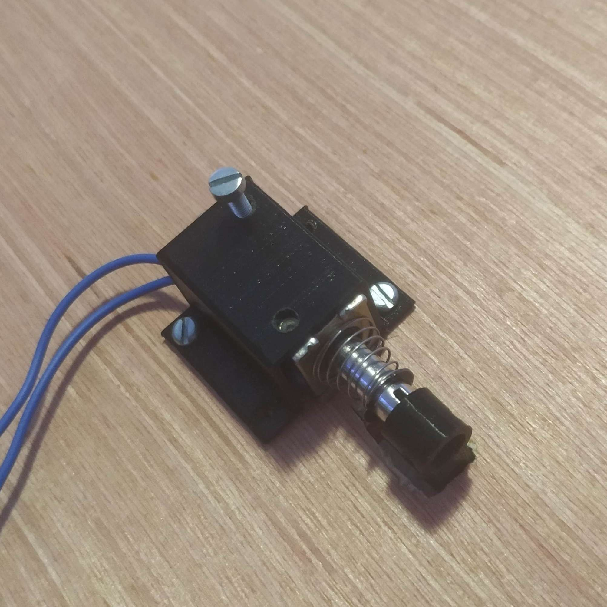

# Session 2

[🇫🇷 French version](french-version/session-02.md)

## Before the session

Starting from the list of components drawn up at the beginning of the project in the specifications, we looked for the references of the components to buy for the pinball machine, in particular by researching the force in newtons and the voltage needed to push the ball hard enough (see the component list). Then we went to several hardware stores to find springs and rubber bands so that we could move the project forward. The spring will be used to build the manual ball launcher.

After receiving rubber bands and balls suited to the project, I built a slingshot prototype by drilling a board and fixing nails into it. This part, located above the flippers, makes the ball bounce off a rubber band when it hits it, to bring the ball back into the playing area. It is made of a stretched rubber band with microswitches glued to it, and a solenoid under the board. The solenoid currently used is: JF-0730B (12V, 5N, 10mm stroke).

It works as follows: when the ball hits the rubber band, the band presses at least one of the 2 switches placed on each side of it. As soon as the signal is received, the solenoid is triggered to stretch the band the other way with a small plastic part going through the board, which pushes the ball back. Here is that part modeled in 3D:

I tested different microswitches to choose the most sensitive ones, so that the slingshot triggers even when the ball arrives slowly. For better sensitivity, a trick is to place the button so that it slightly stretches the rubber band without triggering the switch. Finally, I modeled and printed a bracket to fix the solenoid under the board.

To make the pinball targets, we modeled in Fusion 360 a holder for 3 microswitches and 3 LEDs, one per switch, which light up when their switch is hit. 3 holes at the top of the part hold the LEDs; underneath the part, holes let the wires of each LED and switch through, and 2 more holes fix the holder to the board.

Finally, I modeled a handle in Blender. This handle will be used for the manual ball launcher. The launcher will be made of a wooden rod with a spring, and on one side the handle that the player pulls to launch the ball to the top of the pinball machine.

## During the session

First, I adapted the code written in the first session, which triggered the flipper solenoids with buttons. The slingshots work in a very similar way; the only difference between the 2 programs is that for the slingshots, once the solenoid has been triggered it must retract immediately, even if the switch stays pressed for several milliseconds. So in the program, the solenoid is triggered only when the value returned by the switch goes from HIGH to LOW (but not the other way round, because the solenoid must not fire again when the switch is released). (The commented code is available in the repository.)

Then we fixed the solenoid under the prototype board with small screws and the 3D-printed bracket (the solenoid will be attached more firmly later; this is still a prototype).

The solenoid's arm must be placed slightly behind the rubber band, so that the ball does not hit the plastic part instead of the band (which would not trigger the microswitches), while staying as close as possible to the band so that the solenoid's movement stretches it as much as possible.

We had to run many tests to find the best position for the solenoid's arm and the microswitches, and the right tension of the rubber band, so that the ball correctly triggers the switch (there will be 2 on the final version) and the solenoid stretches the band enough. The prototype lets us check that everything works and determine the position of each element of the slingshot, so that we can later build a part with the right dimensions. Here is a demonstration of the prototype with a ball: https://youtu.be/Ld9HjYVpliU

As we can see, when the microswitch is well placed, the impact of the ball on the rubber band does trigger the slingshot, even when the ball arrives slowly. The prototype therefore seems to work, but the slingshot does not send the ball back very hard, mainly because the solenoid's stroke of only 10mm does not stretch the band enough. To improve this, we may later test another solenoid (with a longer stroke or more force to stretch the band more effectively) or replace the part with a lever system.

At the end of the session, I thought about the best way to fix the microswitches and looked for suitable screws to finish the slingshot prototype. Then we started designing the ball launcher by looking for a wooden rod that fits the springs we had found.
