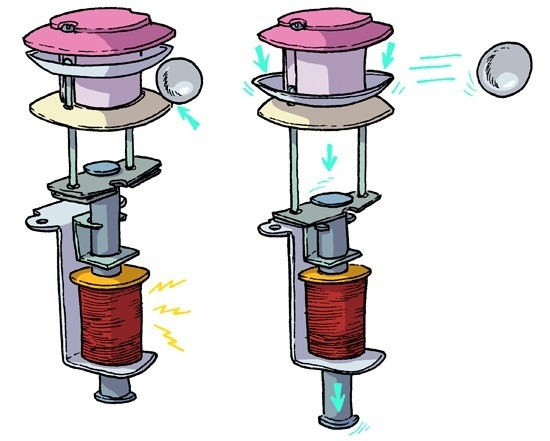
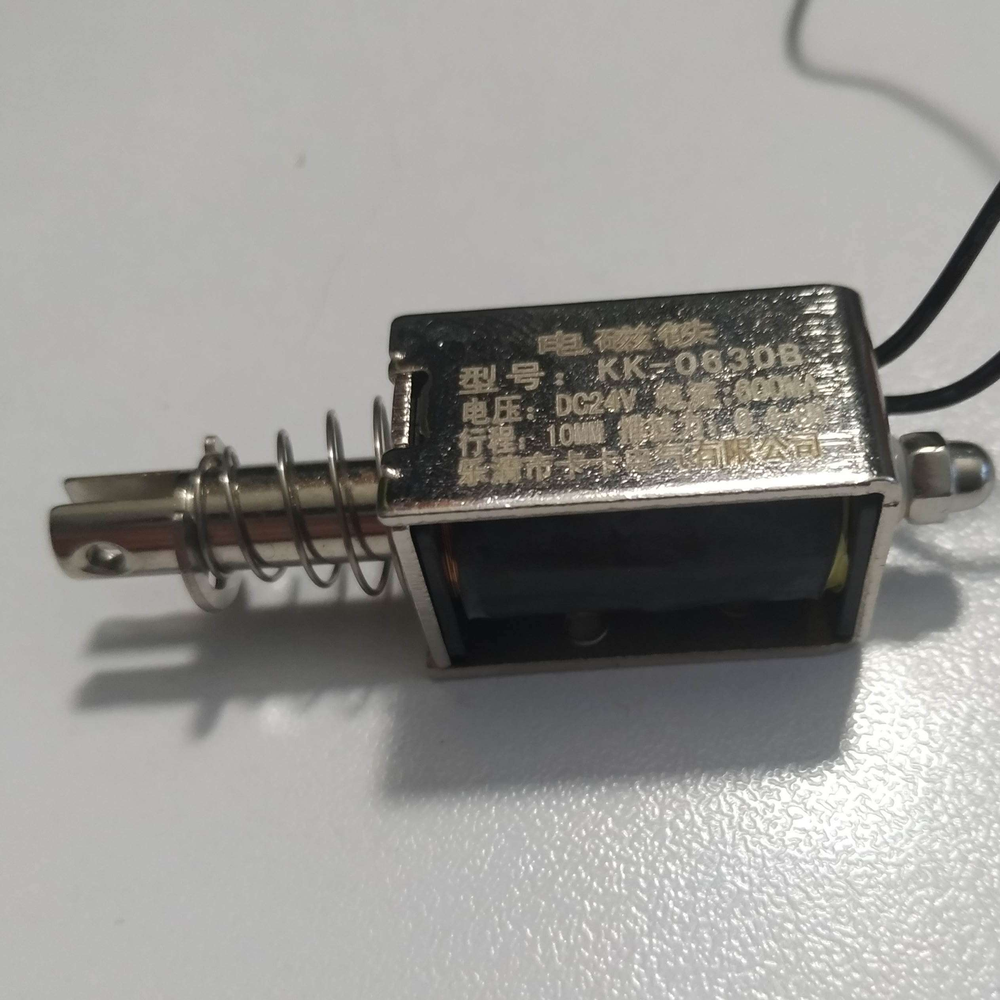
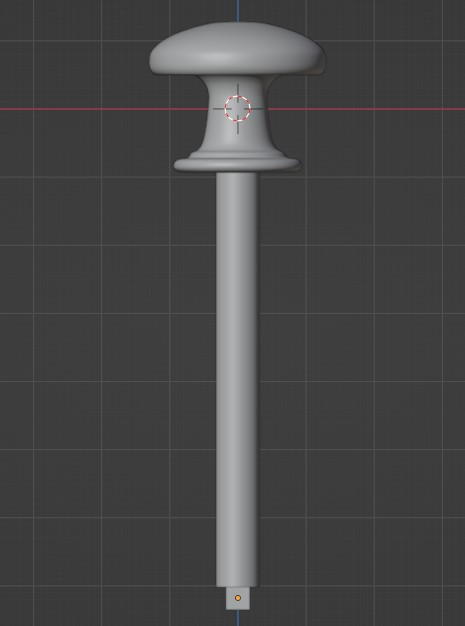

# Session 3

[🇫🇷 Version française](french-version/session-03.md)

When we arrived at this session, we had received new solenoids (model KK-0630B, 24V, 8 newtons, 10 mm stroke), more powerful than the solenoids we were using for the slingshots. These solenoids will be used to build our 3 bumpers. Bumpers are found on every pinball machine: they sit at the top of the playfield, arranged in a triangle, and they score points. They work as follows: when the ball touches a bumper, the player scores points and the ball is sent back in the opposite direction by a mechanism that comes down on the ball and immediately goes back up (see the diagram below).

They are placed quite close to each other so that the ball bounces back and forth between bumpers several times, scoring points in a row.

So during this session we researched the different mechanisms we could use to build them. We decided to use a solenoid placed vertically under the board (held by a bracket) and attached to a plastic part going through the board, which comes down on the ball when there is a contact. To detect this contact, we plan to use copper tape stuck under the bumpers (used as a conductor) and a small metal ring connected to the Arduino's 5V and attached to the top of the bumper. When the metal ball touches both the copper tape and the metal ring, the ball closes the circuit. Reading the voltage of this small circuit on a digital input of the Arduino will detect when the circuit is closed. After this contact, we can add points to the player's score and trigger the corresponding solenoid to send the ball back.

We found this 3D model, which matches exactly what we want to do: https://www.thingiverse.com/thing:3286052.
We will however have to adapt it so that the dimensions of the parts and holes fit our solenoids, which are different.

It took us some time to find a power supply for these new solenoids: the first supply we used was labeled 24V, but its actual voltage measured with a multimeter was 60V. We finally found a supply delivering an actual 24V and 2.2A, which let us test the new solenoids. However, the connector of this new supply has a bad contact, so we need to solve this problem before the next session.

We also ran into a small difficulty with the new solenoids: their documentation stated a 10mm stroke, but in reality they could only move 5mm. To fix this, we simply removed one of the 2 nuts and rubber rings that limit the stroke at the end of the solenoid's rod.

I was then able to test and imagine how a bumper would work with one of these solenoids. Here is the result in this short video showing how it will work (for now the solenoid is triggered manually). The electronic circuit is the same as for the slingshot solenoid, except that the power supply provides 24V instead of 12V: https://www.youtube.com/shorts/0AeFL3rPPoE.

For the next sessions, I will try to print plastic parts to fix these solenoids under the board and to adapt the 3D models of the bumpers to our solenoids so that we can run first tests.

At the end of the session, I decided where to place the microswitches on the slingshot prototype built in the previous session, and I found suitable wood screws to screw the microswitches directly onto the board without having to drill holes.

Finally, I modified the 3D file of the handle used for the manual ball launcher to add a rod that goes into the spring. We had initially planned to glue a wooden rod to the handle, but since we did not find a rod with the right dimensions, and to get a sturdier handle and rod, we will print the rod in plastic as part of the handle. The small cube at the end of the rod will hold another part that hits the ball. Note: the part may be modified again to make it easier to 3D-print and avoid printing supports. Here is the new handle modeled in 3D:

After the session, I received a solenoid that will move the flippers (model KK64B, 24V, 2A, 20mm stroke, 65 newtons). I tested it with the 24V supply, and here is the result in video (the code is the same as in the first session, available in the repository: while the button is pressed, a voltage is sent to the solenoid to activate it until the button is released). https://www.youtube.com/shorts/n7QumtdJi2Y
