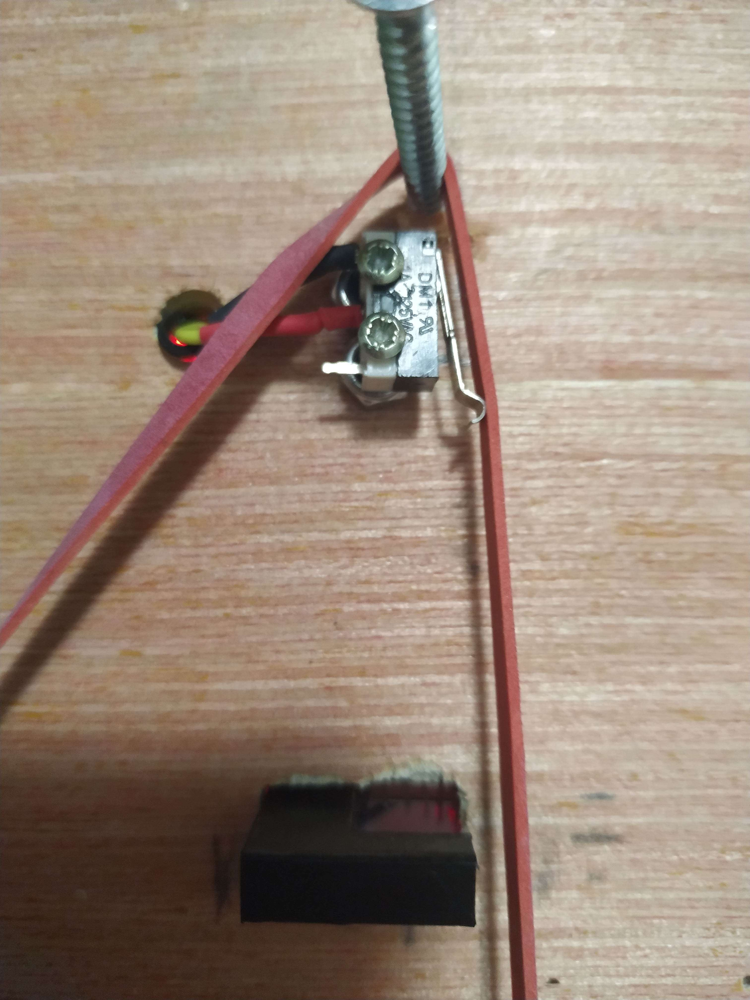
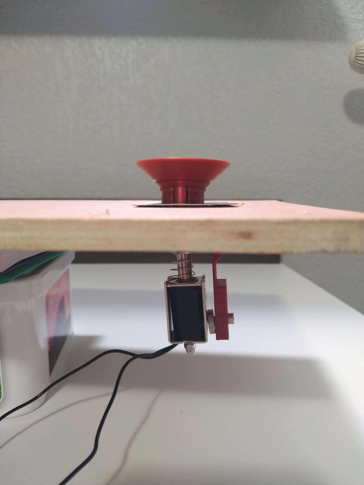
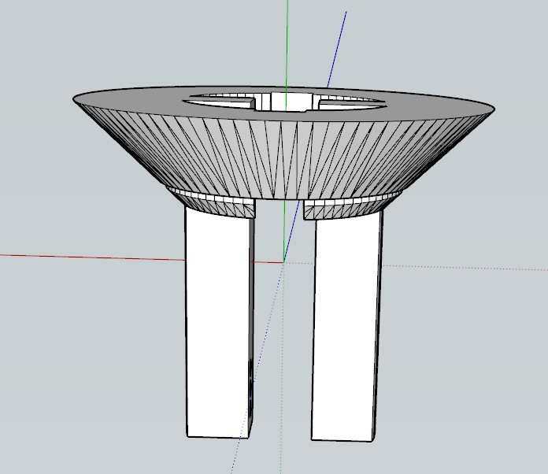
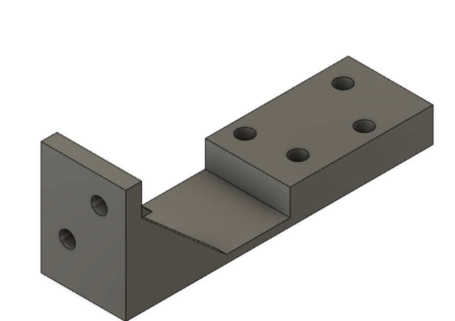
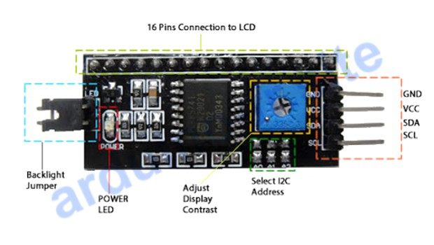
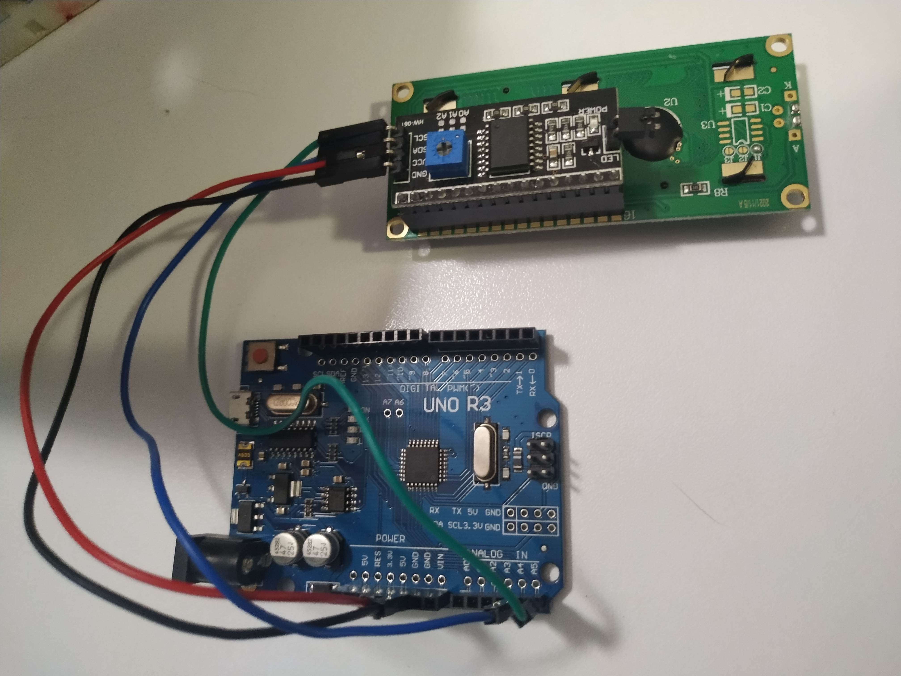

# Session 4

[🇫🇷 Version française](french-version/session-04.md)

## Before the session

First, I fixed one of the 2 microswitches of the slingshot (a part with a rubber band that sends the ball back in the opposite direction, see the previous reports) on the prototype board built in the previous sessions.

This required a lot of care: if the microswitch's lever is not pressed enough by the rubber band, the impact of the ball does not trigger it (unless the ball arrives very fast).
And if it is pressed too much, the lever no longer returns to its initial position after the impact because of the pressure of the rubber band (the switch button then stays pressed all the time).

I had to raise the microswitch slightly above the board so that the ball hits it at the height of its center of gravity, to apply as much force as possible on the lever. For now this was done with 2 small nuts. On the final version, it may be useful to make a dedicated small part. On the final slingshot there will be a microswitch on each side of the rubber band, to get the same impact sensitivity on both sides.

After many tests to fix the microswitch in the best position, here is the result: https://youtube.com/shorts/6lyibMg2PRw

I then built a bumper prototype with a solenoid (KK-0630B, 24V, 10mm stroke, 8 newtons) on the prototyping board I had used for the slingshot. To do this, I used this design: https://www.thingiverse.com/thing:3286052. The bumper is made of two parts: the cone that comes down on the ball, and a fixed part that keeps the cone straight and in which the first part slides.

I imported these parts into 3D modeling software and changed the spacing between the 2 legs that clamp onto the solenoid, so that ours could be attached: it is much smaller than the one used by the author of the 3D files.

It works as explained in the report of session 3: the conical part attached to the solenoid comes down on the ball to push it in the opposite direction. To fix the bumper to the board, I drilled a hole in the prototype and, from the measured dimensions, modeled and printed a bracket that holds the solenoid under the board.

Note: the bracket will be modified later because the part was oriented incorrectly during modeling.

Here is the demonstration in video: https://youtube.com/shorts/1k2h37szUpM

## During the session

After presenting the progress of our project in a 10-minute talk, we started building the system that detects the ball touching a bumper. To do this, we cut at the Fablab a thin metal plate the size of the bumper, which will be set into the board just below it. We found a stiff wire that we will insert into a groove at the top of the bumper part. When the ball rolls on the metal plate and touches the wire at the same time, the bumper is triggered and the Arduino receives a signal to add points to the player's score.

I noticed that the vertical movement of the 3D-printed conical part of the bumper is stopped by the board, so we do not use the whole stroke of the solenoid's plunger. This is because the legs of the conical part are not long enough. I modified the 3D model to make them longer, so that the bumper starts from a higher position and the solenoid can use its full stroke.
I also added the groove that will hold the piece of metal.

Finally, I looked into how an LCD screen works, which will display the player's score throughout the game and possibly messages about the game. The LCD screen is a "QAPASS 1602A". Since we need to keep many pins free for the many components of our pinball machine, we reduce the number of connections an LCD display needs by using an I2C serial interface (model HW-061) between the Arduino and the display.

To connect this interface to the screen, I soldered a pin header on the screen and inserted the 16 pins of the interface into it. The program to drive the screen and display the score will be written before the next session.

