# Session 5

[🇫🇷 Version française](french-version/session-05.md)

## Before the session

First, I tested the LCD screen to display messages and update the score. The screen is connected to an I2C module, so only 2 communication wires connected to the Arduino's analog inputs are needed, in addition to its power supply (on an Arduino Uno board, the SDA pin is connected to analog pin A4 and the SCL pin to A5). At first the screen did not seem to work and no message was displayed, but we simply had to turn the small screw on the back to adjust the contrast. Here is a simple test program:

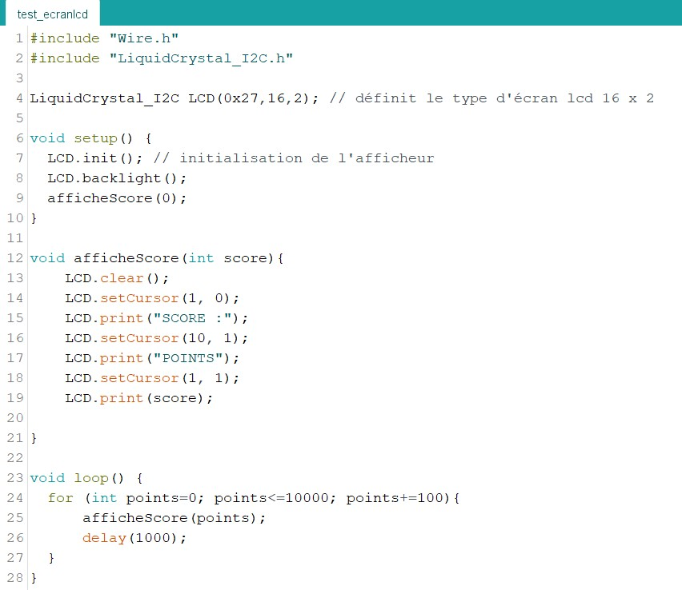

The afficheScore(int score) function displays any score on the screen. It is called in setup() with the value 0, because every game starts with 0 points. For testing, I wrote a for loop in loop() that adds 100 points every second up to 10000. This function can be optimized later.

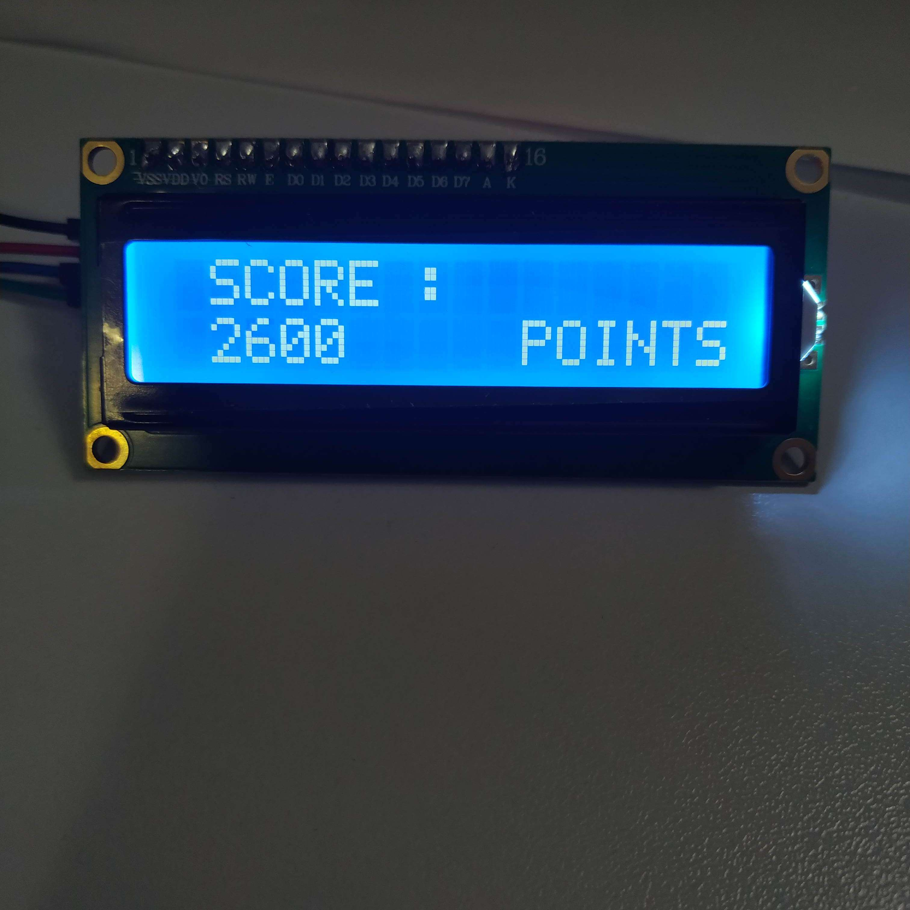

During the Christmas holidays, I worked on building the flippers. To model them, I used the real dimensions of a flipper. I decided to split the mechanism into 3 parts: the flipper, which is the part that hits the ball, with a hexagonal shaft that fits into the next part.

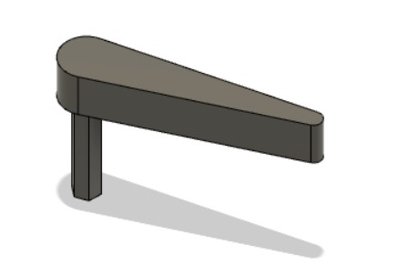

The 2nd part is a flipper "arm"; it sits under the board and converts the translation of the solenoid into a rotation. It is connected to the solenoid by a 3rd part that rotates around its axis.

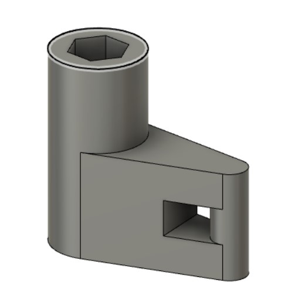

The 3rd part connects the solenoid to the flipper arm.
To do this, I insert this 3rd part into the 2nd one by pausing the 3D print, so that it is trapped inside the 2nd part and can rotate around it. This avoids adding extra screws. This part is essential, because I could not easily attach the solenoid, which moves linearly, directly to a part that rotates.

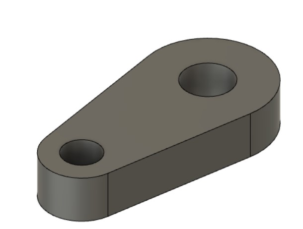

Here is a view from under the board of the solenoid + arm connector + flipper arm assembly:

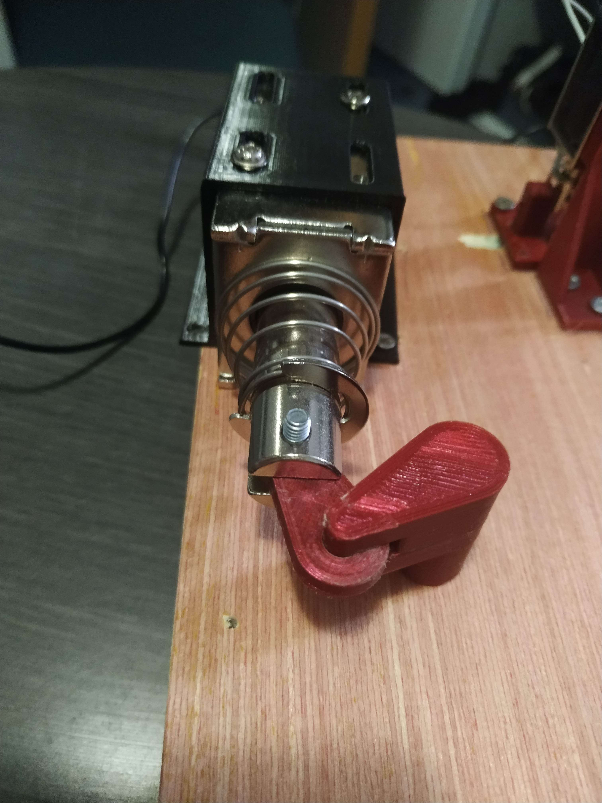

I also modeled a bracket to fix the solenoid under the board. Positioning the solenoid correctly was difficult: it must be placed precisely so that the shaft of the 3D-printed part does not take any extra load; otherwise the solenoid jams and its spring does not bring it back to its initial position. To adjust the position of the solenoid more easily, I replaced the round holes of the bracket model with slots. Washers under the screws will then make sure the part is properly fixed. I was then able to fix the solenoid to the board by drilling a hole and screwing the bracket.

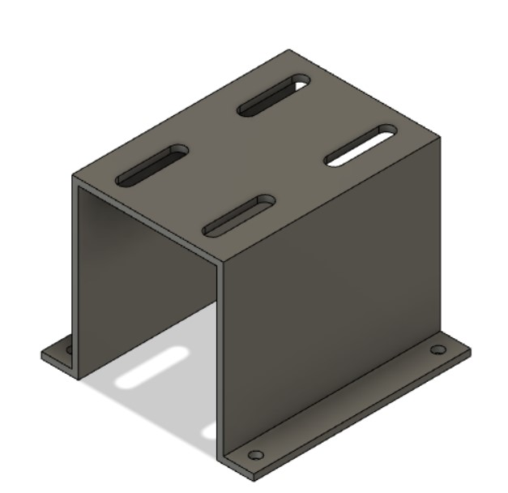

Here is the flipper test in a short video:
https://youtube.com/shorts/JcDkgeMB18o

I then added a circular notch in the bumper model in Blender to insert an electric wire that the ball will touch. I also had to change the height of the part so that the ball properly touches both the board and the bumper's wire.

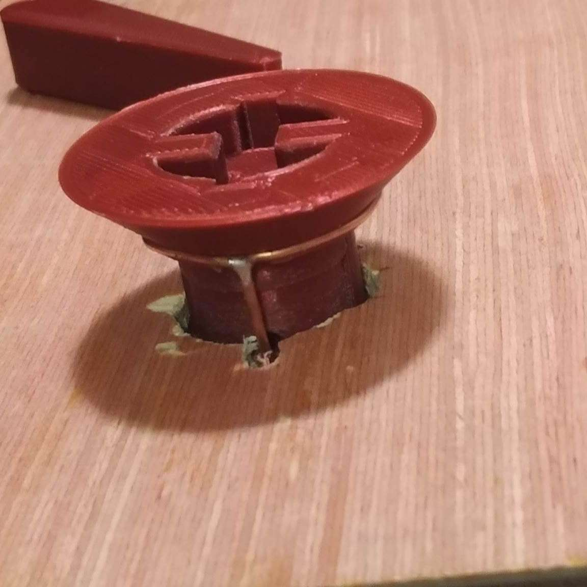

Since the slingshot (a part with a rubber band that sends the ball back into the playing area by stretching the band) did not send the ball back hard enough, because of the short stroke of the solenoid (10mm) and its low force (8 newtons),
following our teachers' advice, I completely redesigned the 3D model of the slingshot to include a lever system. It gives a larger range of motion and more force. I first built a prototype with several holes to test the best position and length of the bar the lever pivots on.
Here is the result after many tests and changes to the printed part:
https://youtube.com/shorts/K7FTkk97wYo

I then modified the printed part again to include these improvements, so that I had a clean part I could also reprint for the 2nd slingshot.
Here is the modeled bracket of the slingshot's solenoid, and the lever:

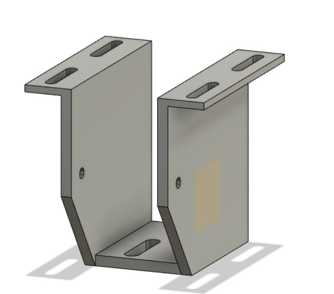

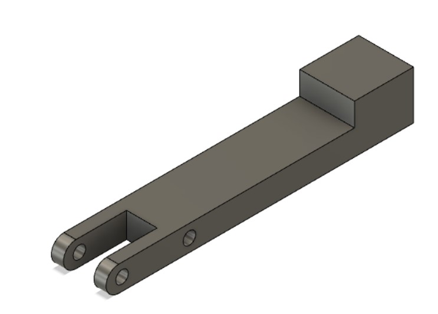

Since we had to spend a huge amount of time on the prototypes to place the components correctly on the board, I decided to create a 3D model of the whole pinball machine in SketchUp, to have all the measurements we need and save time and precision on the final version. I took many measurements on the different prototypes built in the previous sessions to determine the exact position of each component. I then imported all the parts modeled so far to place them. A few elements will be added to the model soon.

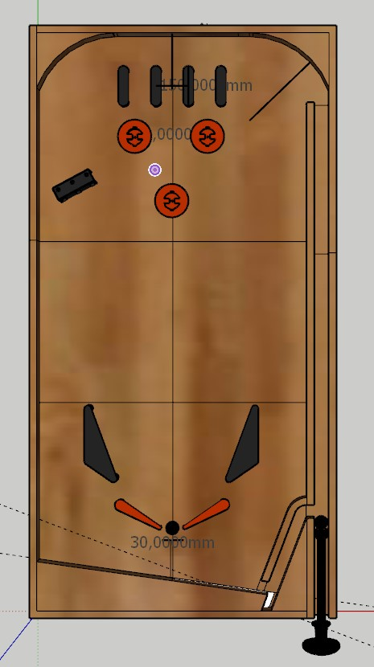 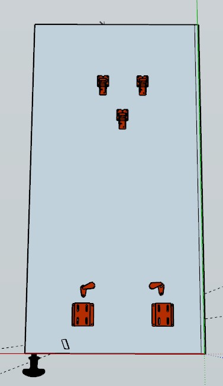

Finally, I used these holidays to finish modeling the handle in Blender, to get a handle with a good grip. The handle is attached to a rod around which a spring is placed. However, printing it in one piece with its rod would have needed a lot of supports. So I split the part into 3 threaded pieces to avoid supports; this also lets us insert the rod into its future wooden frame on the board. The filament is wood-imitation PLA, hence the strong resemblance to wood. Here are the 3D-printed pieces before assembly:

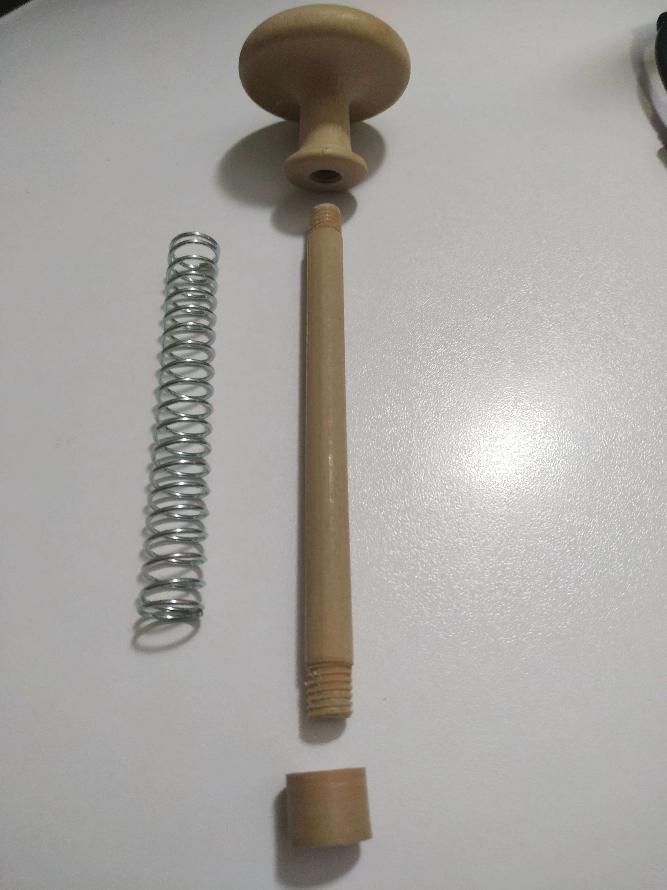

And here is the assembled handle (no screws or glue, since everything screws together thanks to the threads).

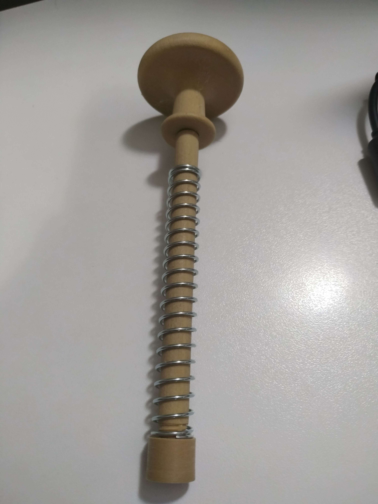

This handle took me a lot of time, because Fusion 360 is not well suited to meshes with many points. So I made the thread separately, then imported it into Blender to insert it into the handle while filling the holes in the part's geometry. I also learned how to create threads in Fusion 360. For the 2 pieces to screw together easily after printing, it is very important to modify one of them to reduce the thickness of its thread (by about 1mm), because of the precision difference between a machined part and a 3D print.

## During the session

First, we had to cut the playfield board to 414 x 800 x 0.5 cm, the dimensions defined in the 3D model. However, as explained in the previous report, the bumpers need thin metal plates set flush with the board (to detect when the ball touches both the plate and the bumper's electric wire), and our board is too long to fit entirely in the laser cutter. With the advice of the FabLab managers, we decided to glue 3 small 3mm wooden boards onto the large board, so that each small board could be engraved with the laser before being glued side by side onto the large board.

To place the infrared sensors, we use a thin plexiglass plate set flush with the board, again thanks to an engraving. I ran tests with an infrared sensor under the plexiglass plate to check that the ball is still detected through the transparent plate. The ball is correctly detected if the sensor is placed right against the plexiglass plate.

Then I determined the dimensions and position of this plate according to the position of the lane separators (black parts at the top of the pinball machine in the model).
Redha then created an SVG vector file in Inkscape to engrave and drill holes in the upper part of the pinball machine.

I then continued the 3D model of the pinball machine to draw its outline and the launch lane. This will make it easier to cut pieces of wood to the right dimensions later.
To do this, I used construction drawings of real pinball machines to create the curves at the top, which let the ball leave the launch lane and enter the playing area.

I then drew the ball exit ramp, which must guide the balls to the launch lane. Since the ball exit (at the level of the flippers) is much lower than the ball's position before launch (just above the handle's rod), we decided to use a solenoid to push the ball up to the launch lane. This solenoid will be triggered each time a ball drains (detected by an infrared sensor). It will push the ball with the same 3D-printed arm used in the old slingshot prototype (black part in the picture below) and will be placed at the hole at the bottom right of the model.

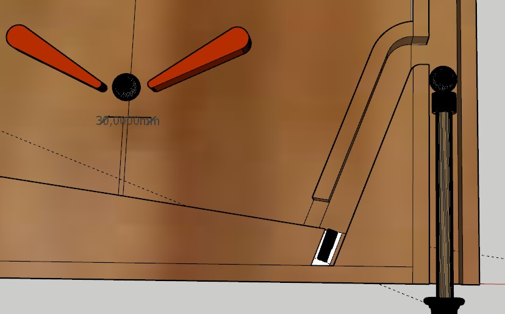

Finally, I modeled the parts that will stretch the rubber bands of the slingshots, following the iconic shape found on every pinball machine. Here is the model in Fusion 360:

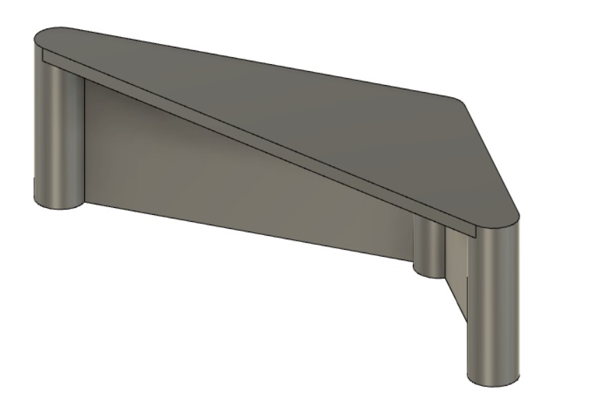
