# Session 6

[🇫🇷 French version](french-version/session-06.md)

## Before the session

We finished an SVG vector file in Inkscape defining our engravings and cuts for the upper part of the pinball machine, so that we could use a laser cutter.

These holes are used in particular to fix our bumpers, and the square engravings to set 3 metal plates flush with the surface of the board, to detect when the ball rolls under a bumper.
The large rectangular hole holds a plexiglass plate with an infrared sensor underneath to detect the ball passing.

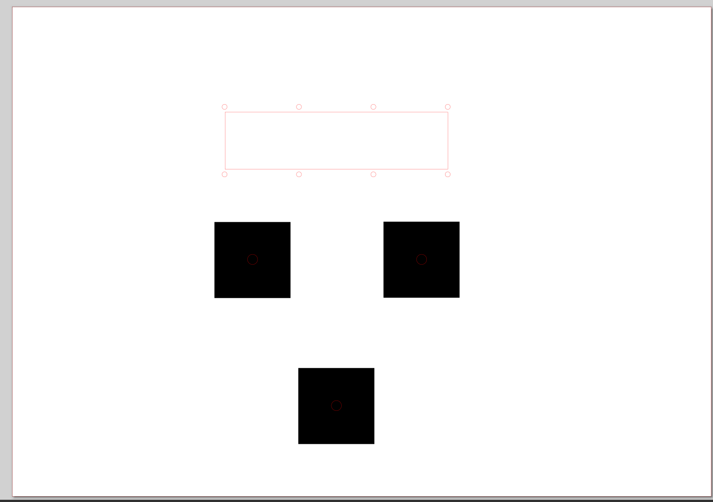

As a reminder, since our 414 x 800 x 5mm playfield board is too large to fit directly in the laser engraver, we decided to glue 3 small 3mm boards onto it so that we could engrave them.
Redha made the SVG files for the upper and lower parts of the pinball machine, and I positioned the elements from the virtual model of our pinball machine.

I then created a vector file to engrave a design in the middle of the pinball machine by combining images found online. To do this, I converted images to SVG, then imported them into Inkscape, positioning and resizing them according to the total size of the middle board.

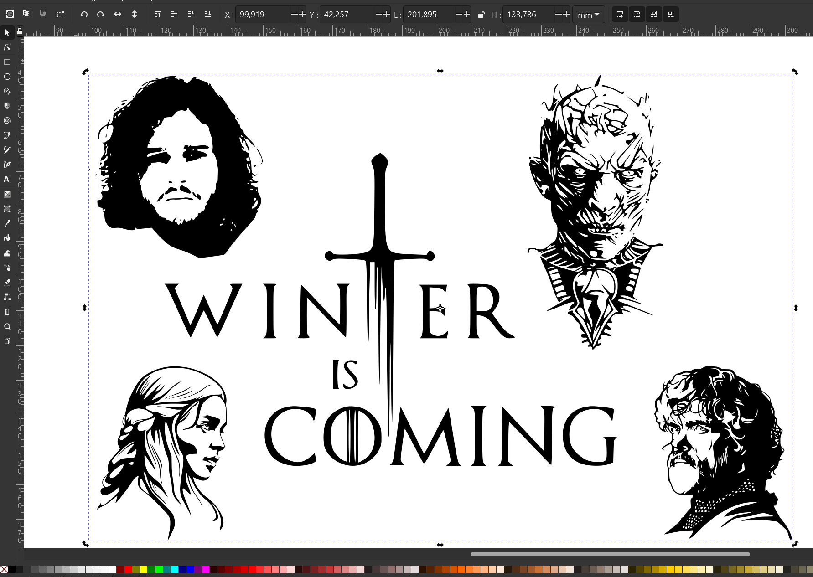

We decided to give our pinball machine a Game of Thrones theme, so we had to plan the decoration ahead by engraving this board, because once glued onto the thick board, no more engraving would be possible.

And here is the final result of the engraving of the upper part of the pinball machine, with one of the metal plates in place:

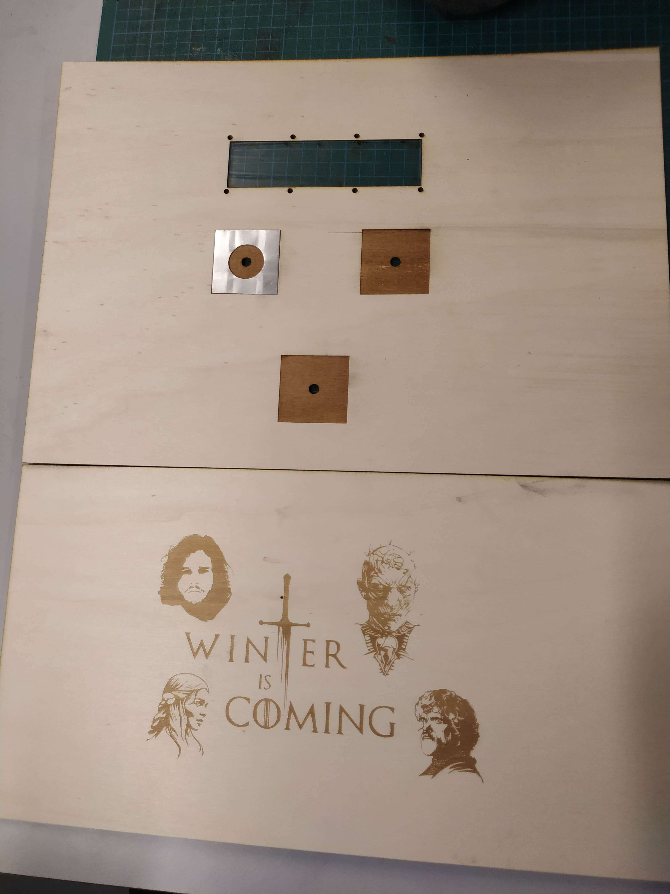

I also determined the exact position of all the elements at the bottom of the pinball machine in our 3D model.

I had to adapt the previous model of the slingshot lever (a part with a rubber band sending the ball back into the playing area), because I found that the lever system took too much space and prevented installing the lanes to the left and right of the slingshots. So I reduced the thickness of part of the lever, making sure that it still applies as much force on the rubber band and that the part stays rigid. Here is the comparison between the old and the new model:

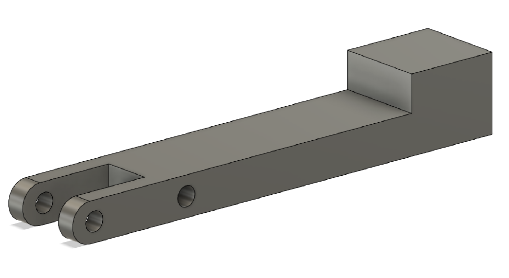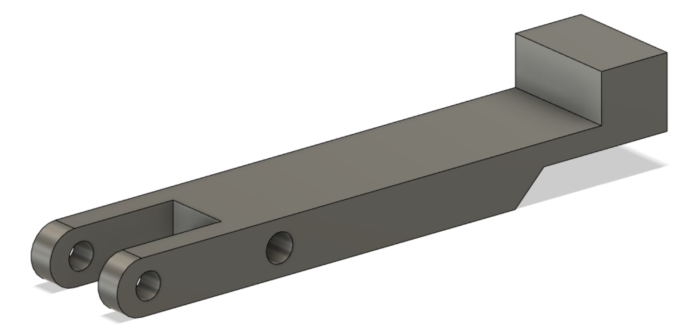

I also had to modify the model of the part that stretches the slingshot's rubber band to make it larger, to be sure that the lever can complete its full stroke without the rubber band preventing it from returning to its initial position; the lever's stroke now lies between the front and the back of the slingshot's rubber band.

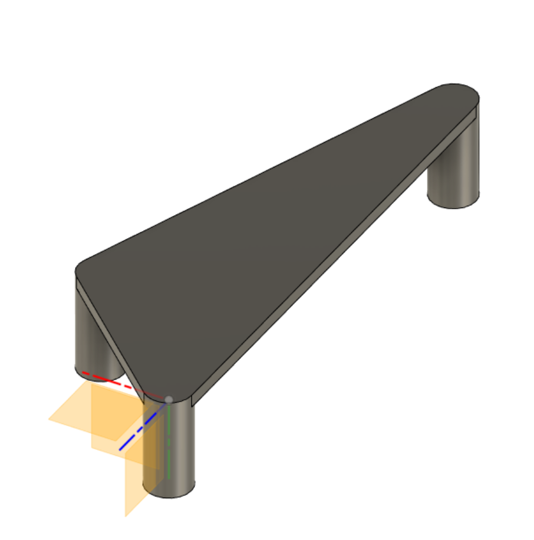

Here is the final 3D-printed part:

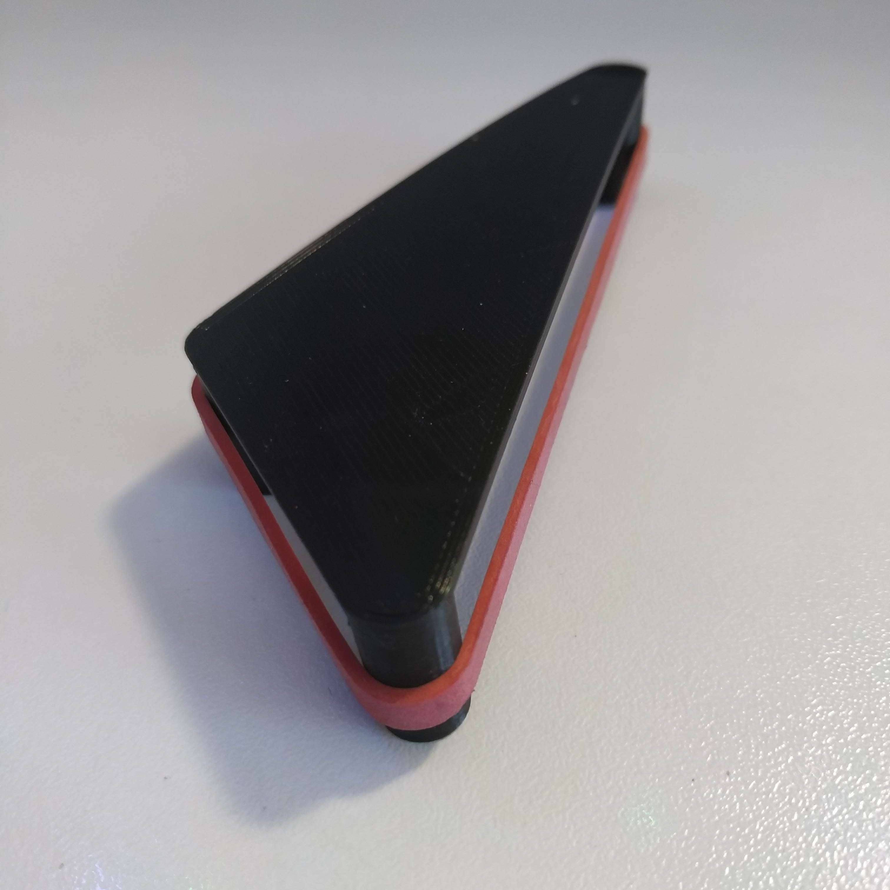

Finally, I placed in the 3D model the hole through the board in which the lever moves.

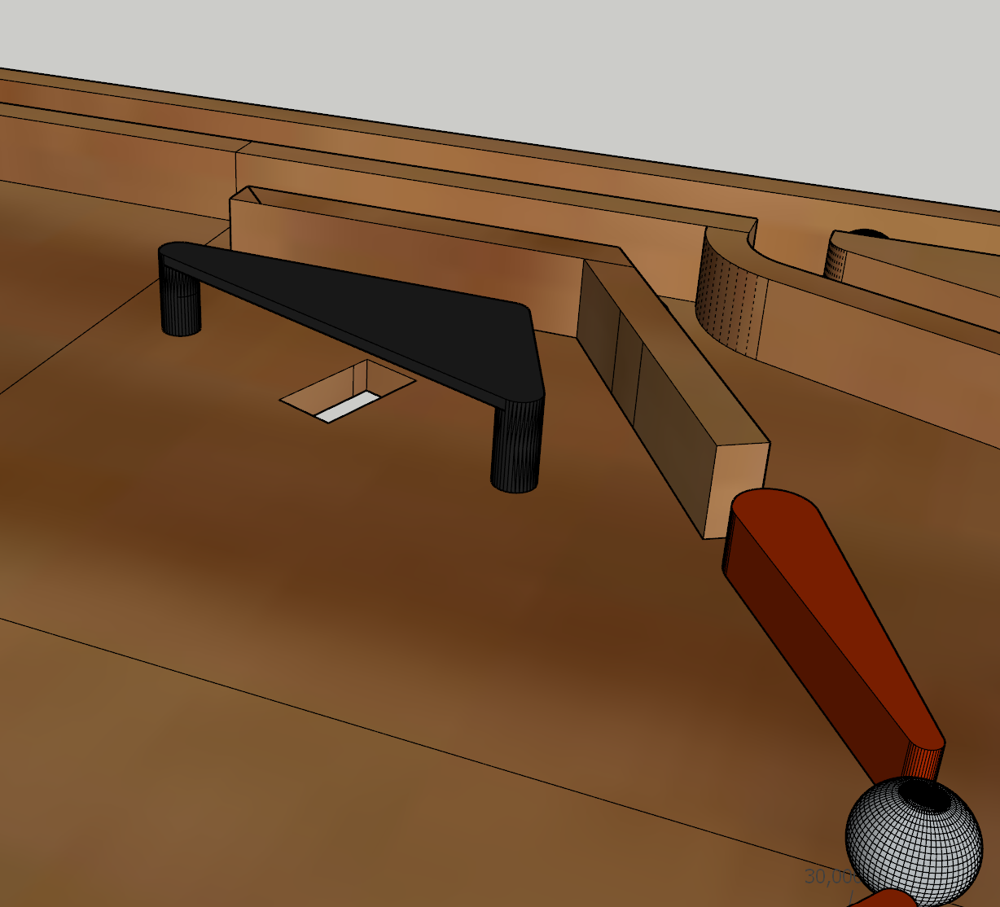

I also modeled and printed the lane separators:

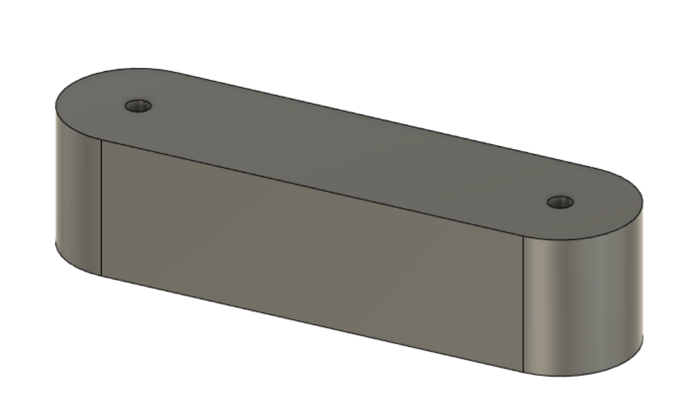

## During the session

Some parts of the outline are curved, so it would have been hard to make them precisely by hand. We decided to make these parts of the outline by laser cutting. To do this, I took the parts modeled in the 3D model, separated them from it and exported them as STL. Here are those parts modeled in SketchUp.

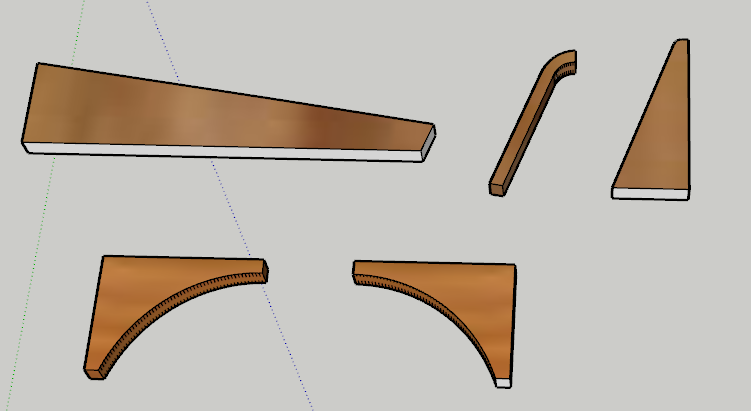

Then I imported them into Blender to turn them into 2D vector files. I used the "outline_to_svg" add-on, which renders a 3D part in 2D by placing a render camera in the desired view. I also had to simplify the geometry of the curves for the result to be usable. And here is the result:

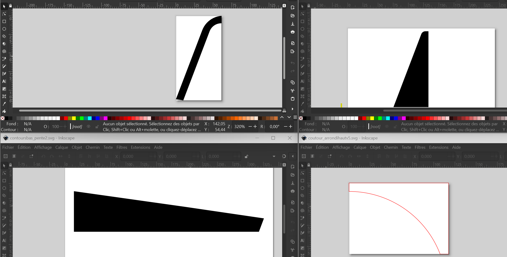

Since the Fablab's laser engraver can only cut boards up to 5 mm thick, we will cut each piece of the outline 4 times from 5 mm boards. Then the 4 pieces of 5mm will be glued on top of each other to get a 20mm-thick border.

I drew the locations of the different infrared sensors so that plexiglass plates could be inserted there, and Redha drew them in Inkscape. (The locations are shown as circles in the picture of the model at the bottom of this report.)

There are 5 on the board, 3 of them at the exits of the game, to detect when the player has lost the ball. We can tell apart a ball leaving through the center of the pinball machine (the player failed to catch it) from balls lost on the sides of the machine, which are not the player's fault. This could, for example, give the player a new try if a ball is lost a few seconds after launch without the player touching it. Some real pinball machines do this with a "ball saved" message and an extra try.

The two other holes are in the upper part of the pinball machine, at the entrance of the future ramps the ball will be able to take.

Finally, I moved the model forward, which allowed us to position the elements to be laser cut and engraved.
On the left of the model you can see the assembly of the 3 vector files we made, which were used to engrave and drill our 3 thin boards.

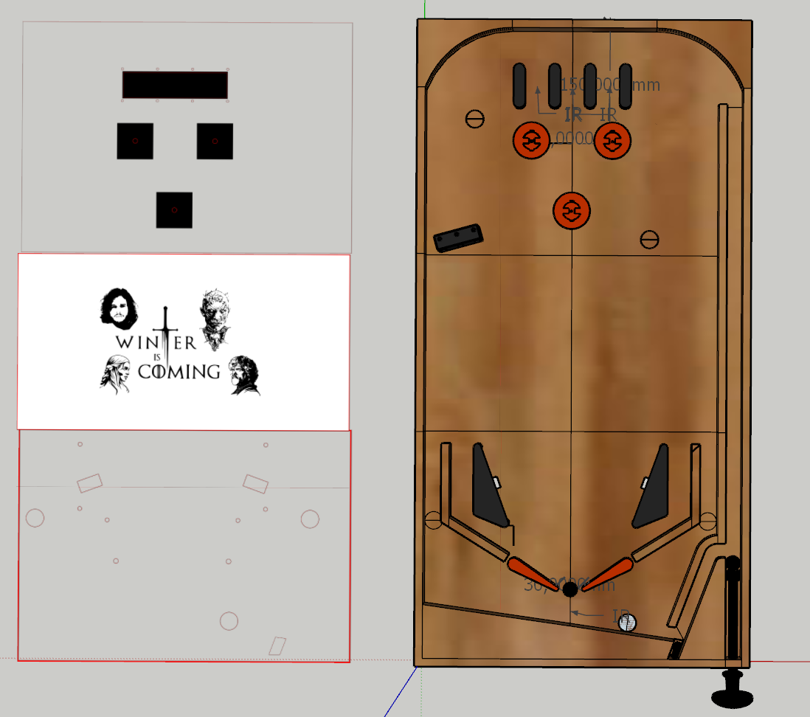
