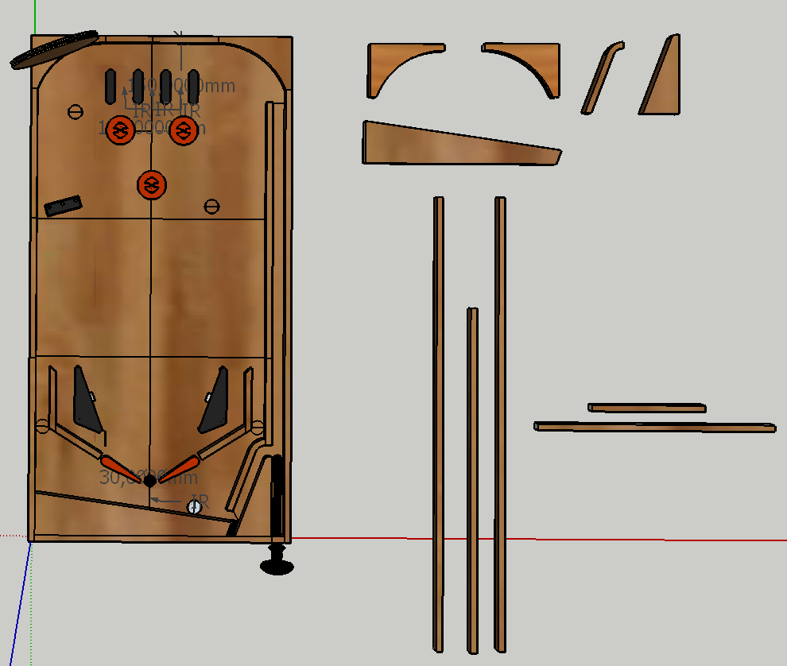
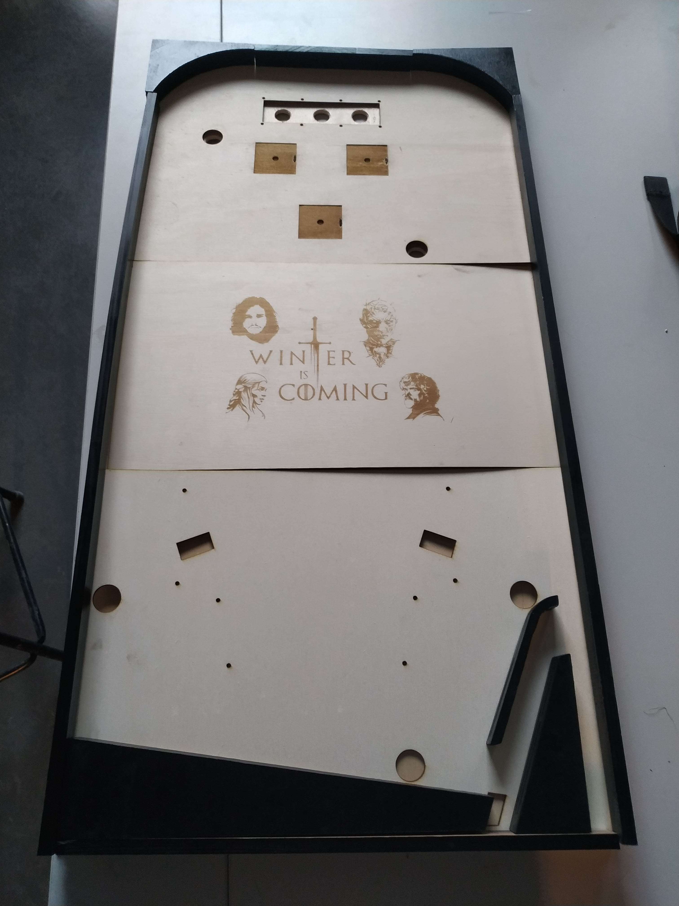
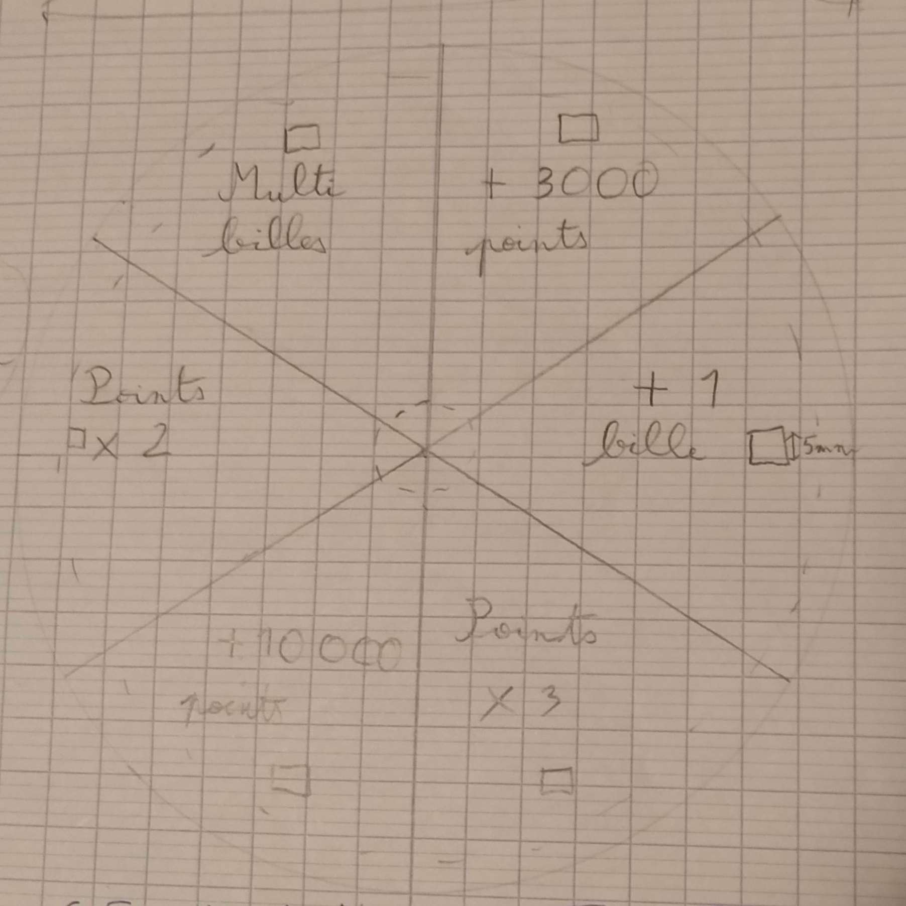
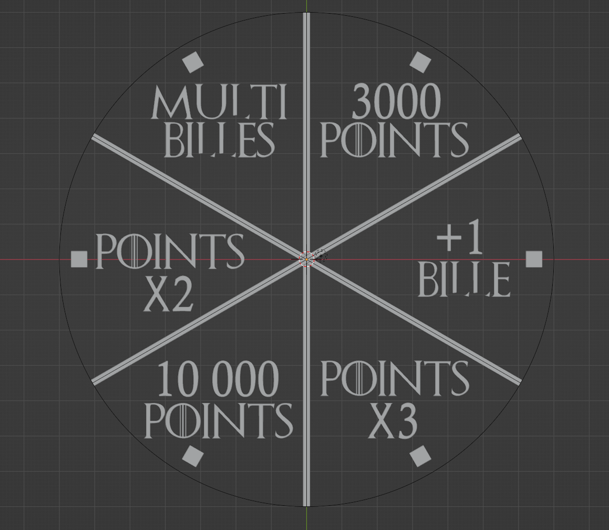
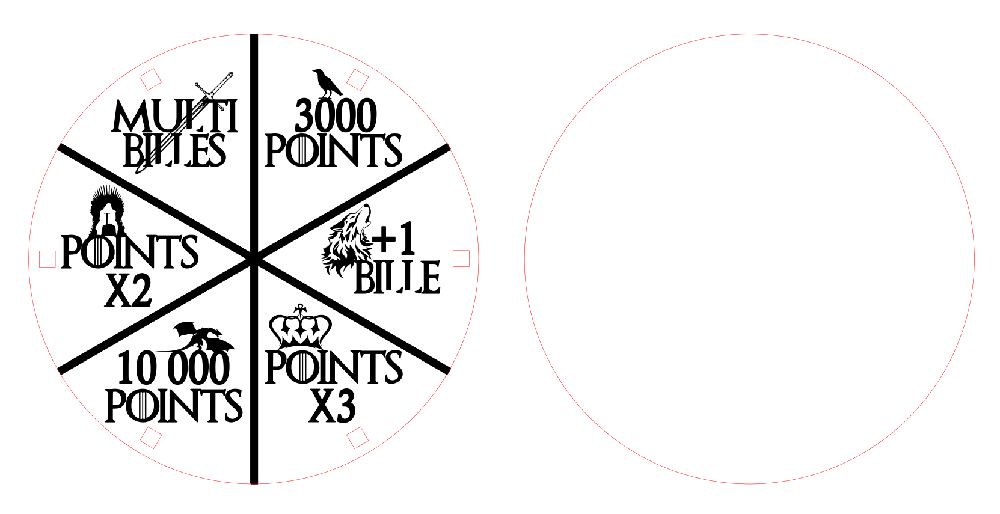
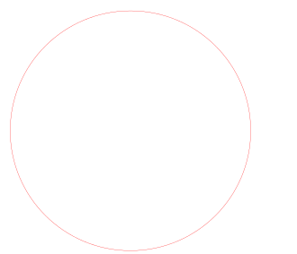
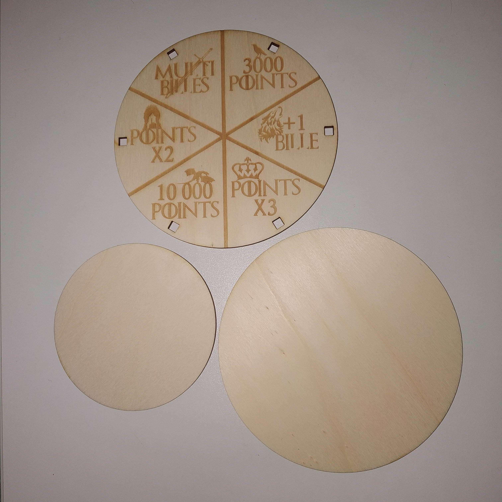
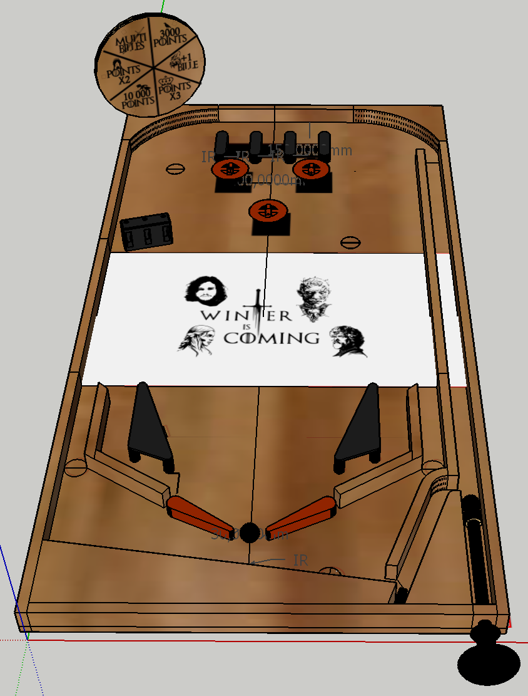

# Session 7

[🇫🇷 French version](french-version/session-07.md)

## Before the session

We finished making the borders of the pinball machine. In the previous session we had already made the curved borders by turning 3D models into a 2D SVG file usable with the laser cutter. As a reminder, each piece had to be 20mm high, and since the laser cutter is currently limited to 5mm-thick boards, we had to glue 4 boards of 5 mm on top of each other for each piece.

This time we cut the remaining pieces of the outline, which are 5 straight pieces of wood.
To do this, we transferred the outline measurements from the SketchUp model onto our pieces of wood with a pencil.
In this screenshot of our model, you can see at the top right the curved pieces made in the previous session, and below them the 5 pieces of wood cut just before this session:

We had to cut pieces 10mm wide, of different lengths and 20 mm high. For safety reasons, the cuts were made by a teacher at the FabLab with a table saw.

Since some curved pieces were slightly burnt during cutting, we decided to paint the whole outline black. I learned how to use a spray can and kept a few tips in mind: shake the can before use, start the movement with the can outside the surface to paint to get a more even coat and avoid drips, and purge the can after use by turning it upside down and spraying for a few seconds.

Here is the result with all the pieces of the outline placed on the board (nothing is screwed or glued yet; this will be done during the holiday week):

Next, I used Fritzing to draw a wiring diagram of the pinball machine, to make sure everything is connected correctly and to save time on wiring day.
For now, I looked up and imported all the components into the software and placed them according to their location on our pinball machine. Then I connected the solenoids to the relays. However, we realized that connecting them in series could cause a loss of power (in the worst case, 3 solenoids can be activated at the same time), so they will have to be connected in parallel.

Since every pinball machine is unique through its decoration and game elements, I wanted to add an element that sets ours apart from a classic pinball machine. I came up with an element inspired by the "Wheel of Fortune" game, which awards a randomly chosen bonus when it is activated.

This wheel could be triggered, for example, when all the targets of the game have been hit, or after the player has taken several ramps in a row.

To build this wheel, I use 6 NeoPixels, which have RGB colors and a strong light while needing only 3 wires for all of them. They will light up the different slots of the wheel according to the bonus won.
I will however face a constraint, since we do not have a circular NeoPixel strip. So I have to cut 6 NeoPixels from the strip, arrange them in a circle, then connect them again by soldering wires, so that the 6 NeoPixels can still be controlled with a single wire (plus the 2 power wires).

I wrote a small animation in Arduino code to get the following result: the LEDs turn on and off one after the other, giving a light effect that goes around the wheel. Then the animation stops on one LED, which blinks to show the bonus won.

I also added a buzzer that beeps each time an LED lights up. So that the NeoPixels are not dazzling, it is better to use values between 0 and 30 in the RGB color code.
Here is the result in video:
https://youtube.com/shorts/hx9wgBHNqKs?feature=share

I chose to build an assembly of 3 laser-cut wooden boards of 3 mm.
The first part is the one visible to the player: a 140mm circle on which the bonuses are written, with 6 holes for the NeoPixels.
The 2nd is a simple circle of the same size, on which I will glue each NeoPixel facing its hole in the first part. Between these two parts, again with the laser cutter, I made a 3rd, smaller circle (100mm in diameter), which will be glued between the two and leave room for the wires connecting the 6 NeoPixels in series.

The whole wheel will be fixed on the upper edge of the pinball machine with a 3D-printed holder, in which I will make a hole for the 3 connection wires.

## During the session

This session let me make the wooden parts of the wheel of fortune.
I started with a sketch on paper to decide the number of slots on the wheel, the location of the LEDs and the bonuses to write on it (I looked into how a real pinball machine counts points).

Here are the chosen bonuses:

- Multiball: triggers an element on the playfield that releases 3 more balls at once, letting the player play with several balls and score more points.

- Points x2 / Points x3: bonus that multiplies the new points won by the player by 2 or 3 for a certain time (for example, the bonus would be turned off after 30 seconds).

- 3,000 points / 10,000 points: adds 3,000 or 10,000 points to the player's score. The code can lower the probability of landing on the 10,000 slot to keep this big bonus rare.

- +1 ball: gives the player an extra try with an extra ball, which can be launched from the launch lane once the other balls have been lost.

I used Blender for this, to be more efficient, since I master it much better than Inkscape. The slots are separated every 60° by 2 mm-wide rectangles. I placed 6 squares of 20 mm to let the NeoPixels through.

For the text, I used a font matching the theme of the pinball machine. I then used an add-on called "Freestyle SVG Exporter", which can be enabled directly in the software's settings. It exports the outlines of a 3D model, as seen from a view, as vectors in an SVG file. To use it, you place a render camera in the desired view and render an image with the add-on enabled.
Finally, in Inkscape, after fixing a few SVG export errors with the help of Redha Abderrahmane, I filled the inside of the letters with black so that they are interpreted as engravings by the cutting software, then placed vector drawings found online in each slot.

And here is the final result after laser cutting and engraving:

I also updated the SketchUp model by adding the wheel of fortune with the SVG image I created, to check the result:

Finally, I started modeling a holder that will be screwed to the rest of the wheel to fix it above an edge of the pinball machine.
