# Session 8

[🇫🇷 French version](french-version/session-08.md)

## Before the session

We used the holidays to spend a few days at the Fablab assembling our pinball machine.
With the help of Frédéric Juan from the Fablab, we started by gluing the 3 thin boards onto the large playfield board, to get the location of all the holes to drill. Then we screwed on all the borders made earlier.

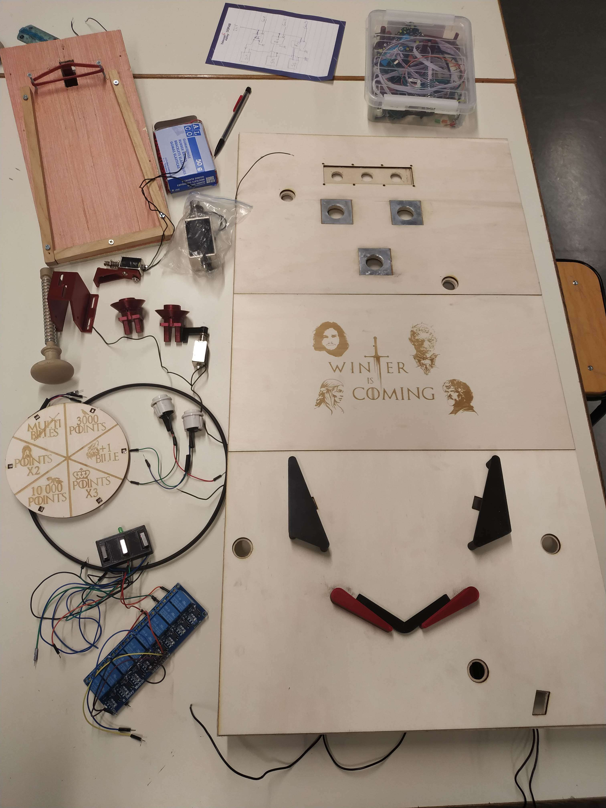

To determine the best slope for our pinball machine, we used a digital inclinometer. Most pinball machines have a slope between 3° and 6°; after testing different slopes with wooden wedges, we chose a slope of 4°. I then measured and drew with a pencil, on pieces of wood, the stand that tilts the pinball machine, so that they could be cut.

We also had to make a hole in the bottom border to insert the handle (modeled in 3D with a thread so that it can be taken apart and inserted into the hole). Because of the force the spring applies to the border, we had to reinforce it at this spot with a taller piece of wood.

To bring the ball back to the launch lane when the player loses it, we screwed a solenoid under the board and attached to it a 3D-printed arm that I modeled. When it activates (that is, when the ball is detected by an infrared exit sensor), the solenoid's arm pushes the ball above the rod of the launch handle.

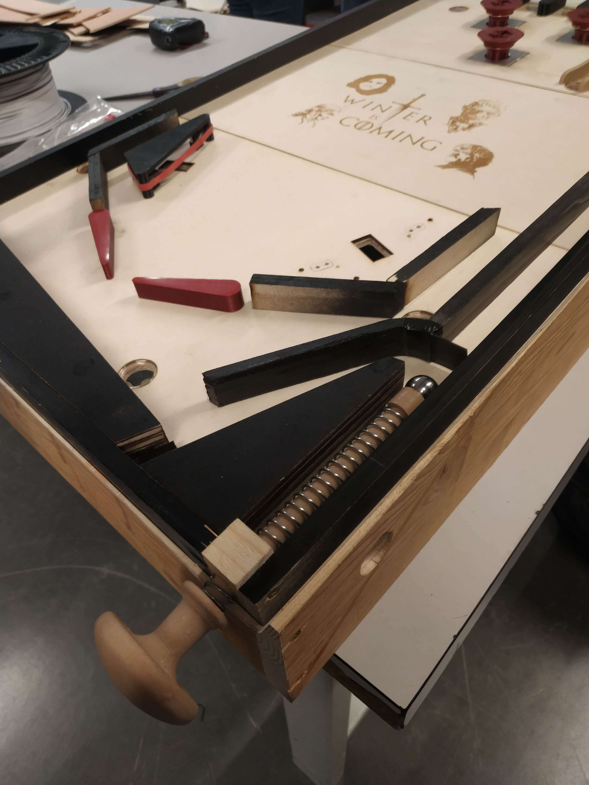

Here is a test of the whole launch area in video:

https://youtu.be/IZiwfpQI0ls

To have everything needed to assemble our pinball machine, I 3D-printed all the parts modeled and tested in the previous sessions.
In particular, I had to change the thickness of the top surface of the slingshots' rubber band tensioners (the parts that send the ball back in the opposite direction), because the parts were bending under the tension of the rubber band.
We had to file some parts to make sure that the mechanical parts (bumpers, flippers and slingshots) move without too much friction.

I spent several hours adjusting the flippers (the parts that hit the ball, controlled by the player) to the right angle. They must be placed perfectly so that they rotate correctly without too much friction. I printed a part giving the angle used on most pinball machines (black part in the photo below). After many adjustments, some binding remained in the mechanism, so I had to file the plastic parts to add mechanical play and make the movements less constrained.

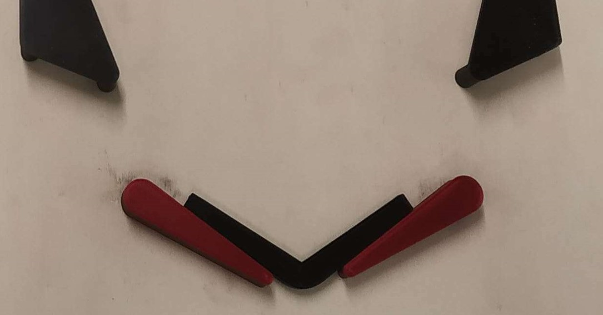

Once all the plastic parts were fixed, we calibrated the sensitivity of our infrared sensors.
Then I screwed them under the board. They had to be positioned so that the emitting and receiving LEDs are very close to the plexiglass plate, so that the ball is detected when it rolls over it. I modeled a holder at the right height, with 3 holes so that the resistors and LEDs of the sensor's circuit fit inside without being damaged. Here is the modeled part:

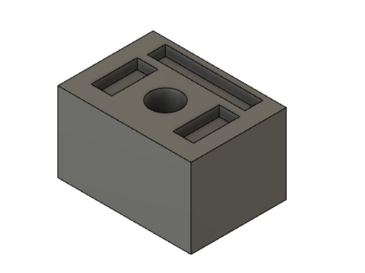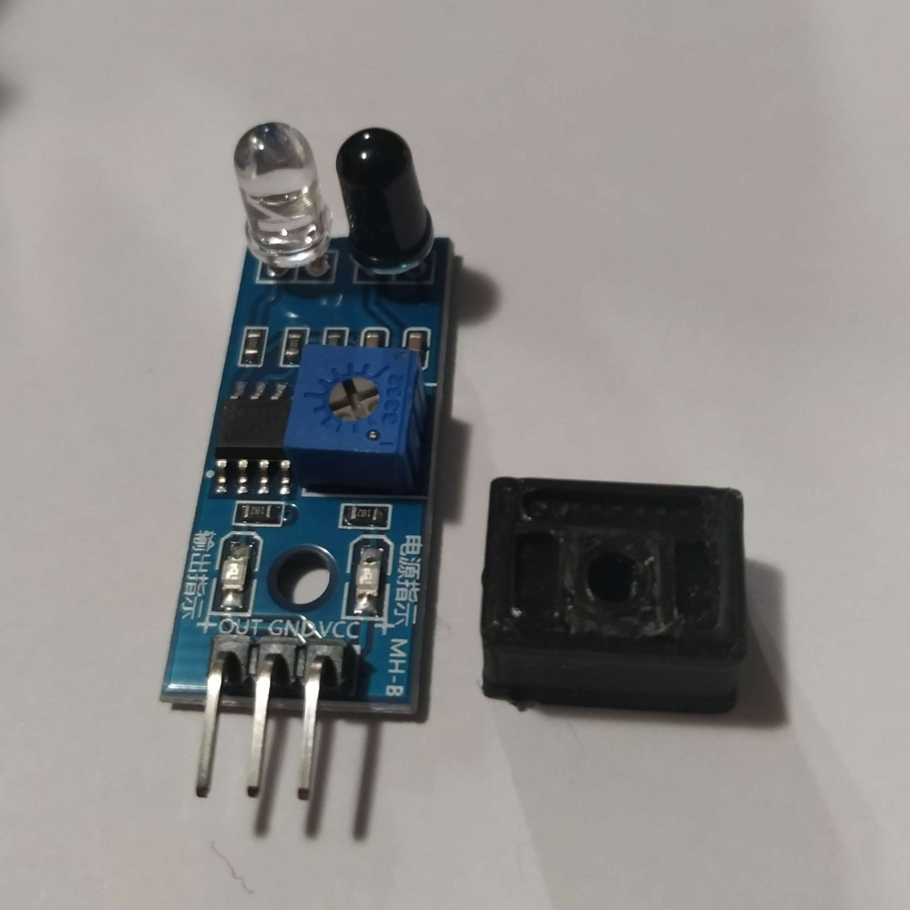
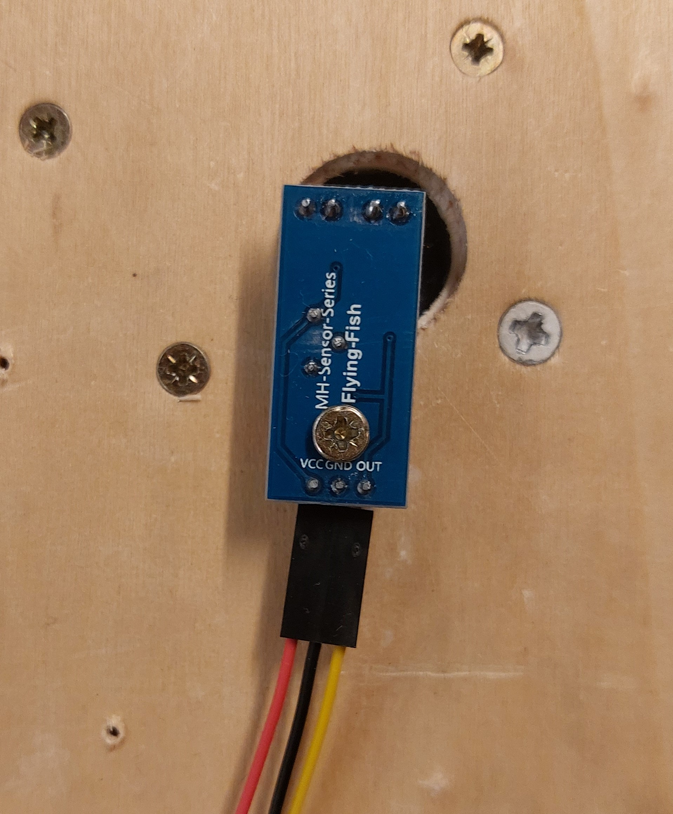

Earlier, I had also made by laser cutting and engraving an element specific to our pinball machine: the wheel of fortune. This game element awards a random bonus, shown by the blinking of the LED associated with that bonus. I had to cut a NeoPixel strip to arrange the NeoPixels in a circle in the holes provided, then solder all the NeoPixels together again so that they can still be powered and controlled with only 3 wires.

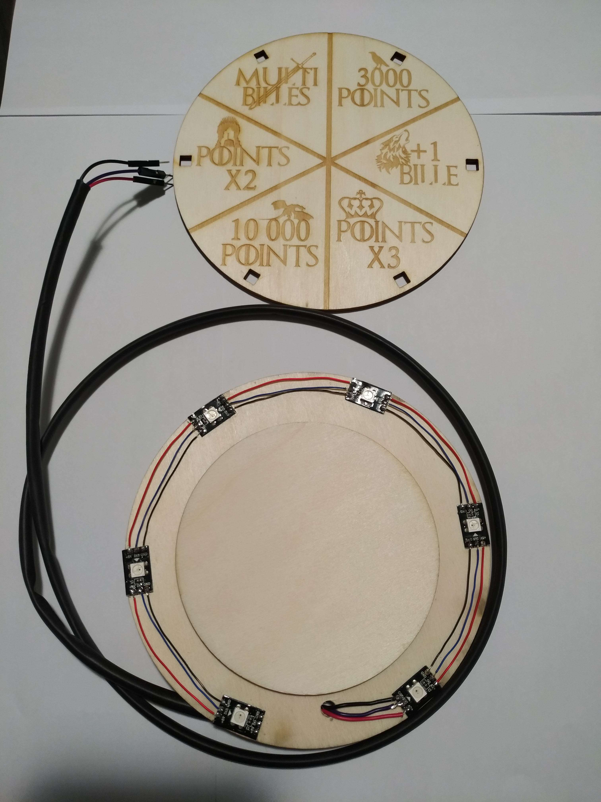

Another very delicate step of the assembly was fixing the microswitches that detect an impact on the slingshots' rubber band. First, I tested different microswitches to choose the most sensitive ones.
Then they had to be placed under the slingshots. As we found when building the prototypes, they must be positioned so that the rubber band puts some initial pressure on the lever, so that they trigger at the slightest contact. Since the slingshot part did not make it easy to adjust their position, I decided to make another, temporary part by copying it and adding a hole inside, so that I could reach in with my fingers to place the switch.

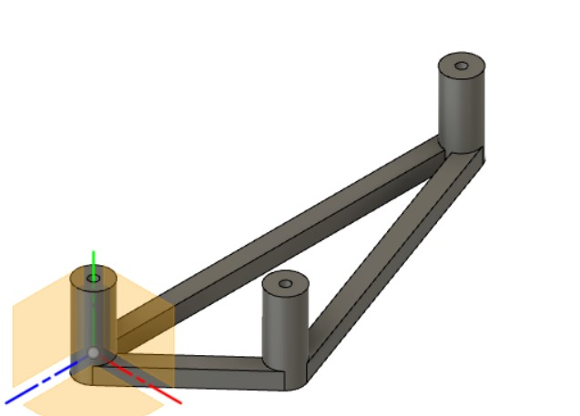

To fix them, I modeled and printed 4 holders that raise them to the right height. Once the best position was found, I traced their outline on the board with a pencil to drill holes and screw them in place.

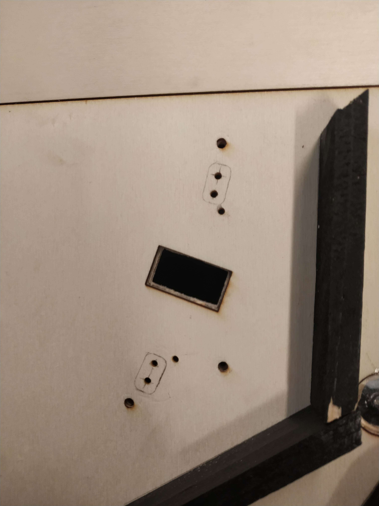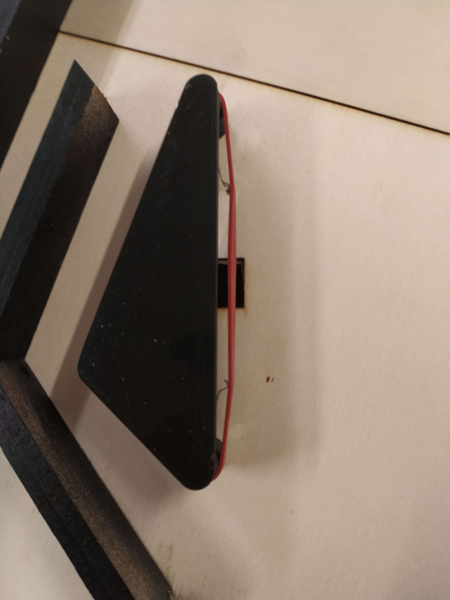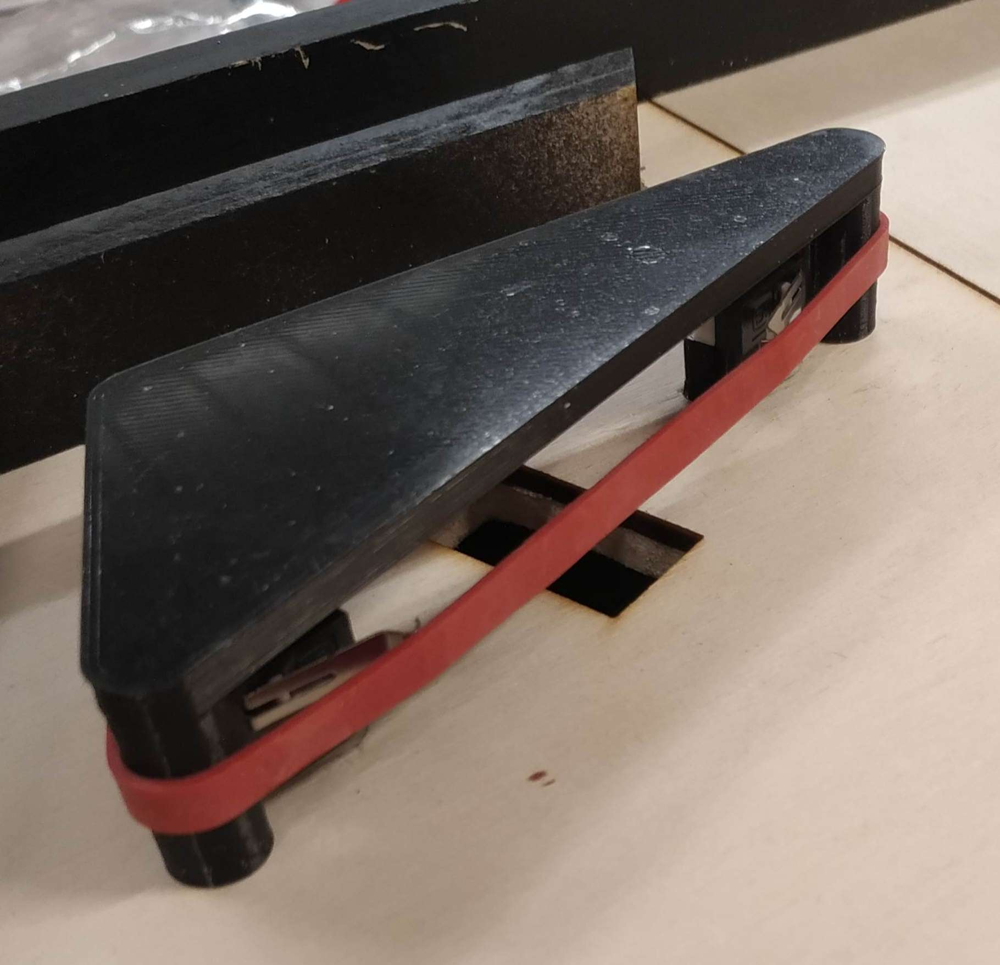

During the time left before the session, I fixed the different electronic components under the board, while setting the converter with a multimeter so that it turns the 24V into a 5V output to power the Arduino and the components that need 5V.

Finally, I modeled the ramp entrance in 3D. I ran several tests to determine its slope so that the ball can reach its top. The rest of the ramp, on which the ball will roll, still has to be made by bending electric wire. Since the infrared sensor that counts a pass on the ramp in the score could be triggered when the ball simply passes in front of the ramp, I added 2 barriers 20 mm long to the ramp to avoid counting a ramp pass by mistake.
Also, if the ball passes in front of the infrared sensor again very shortly after the first pass, it means the player did not manage to send it to the top of the ramp, so no points will be added.

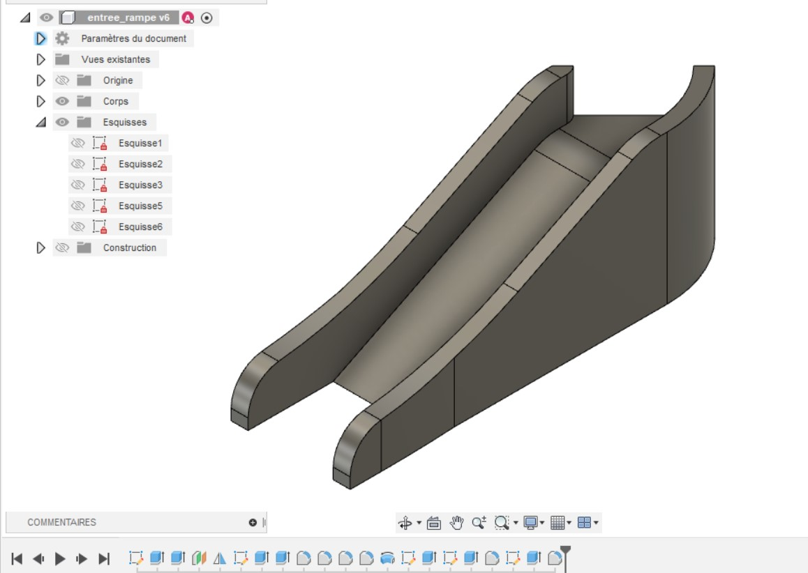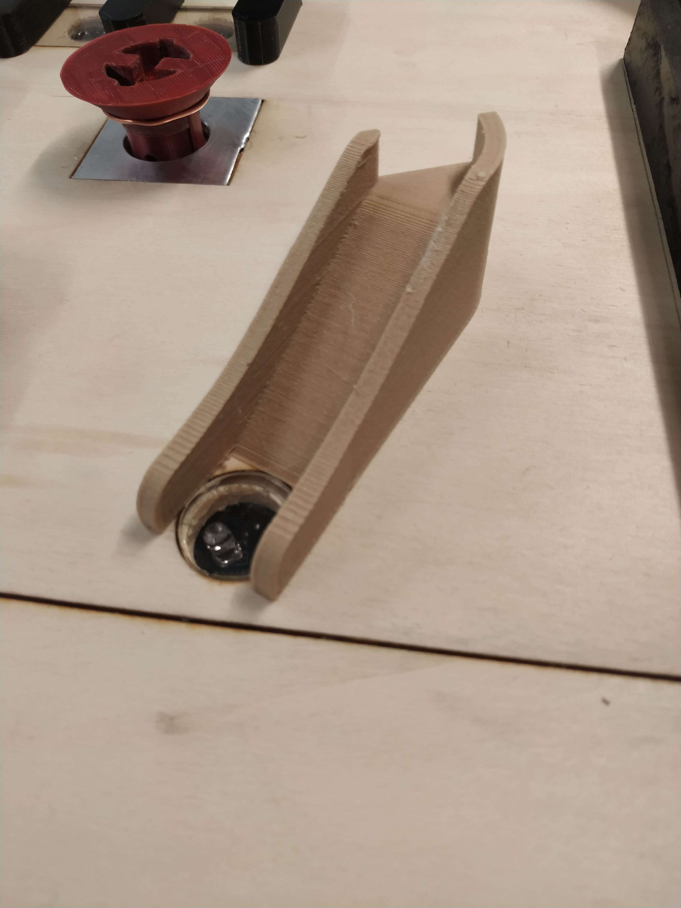

Here is the progress of the pinball machine before the session:

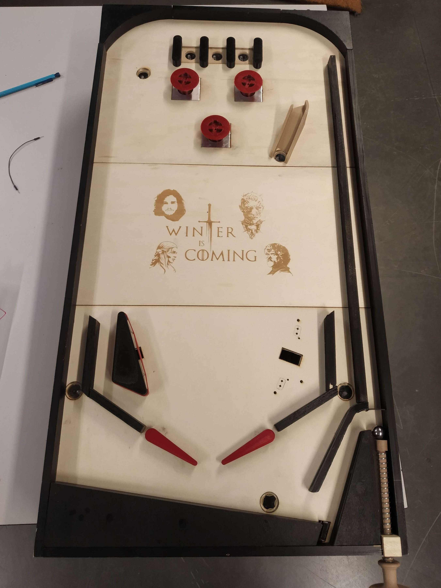

## During the session

Given the little time left before the final presentation, and since all the main components now fixed work correctly mechanically, we decided to focus fully as a team on wiring the components, to be sure to present a working version. We started by wiring all the solenoids in parallel so that each solenoid gets the same voltage.
To connect all the solenoid grounds together, we used 2 Wago lever connectors, one for the top of the pinball machine and one for the bottom, both linked by a wire to get a common ground.
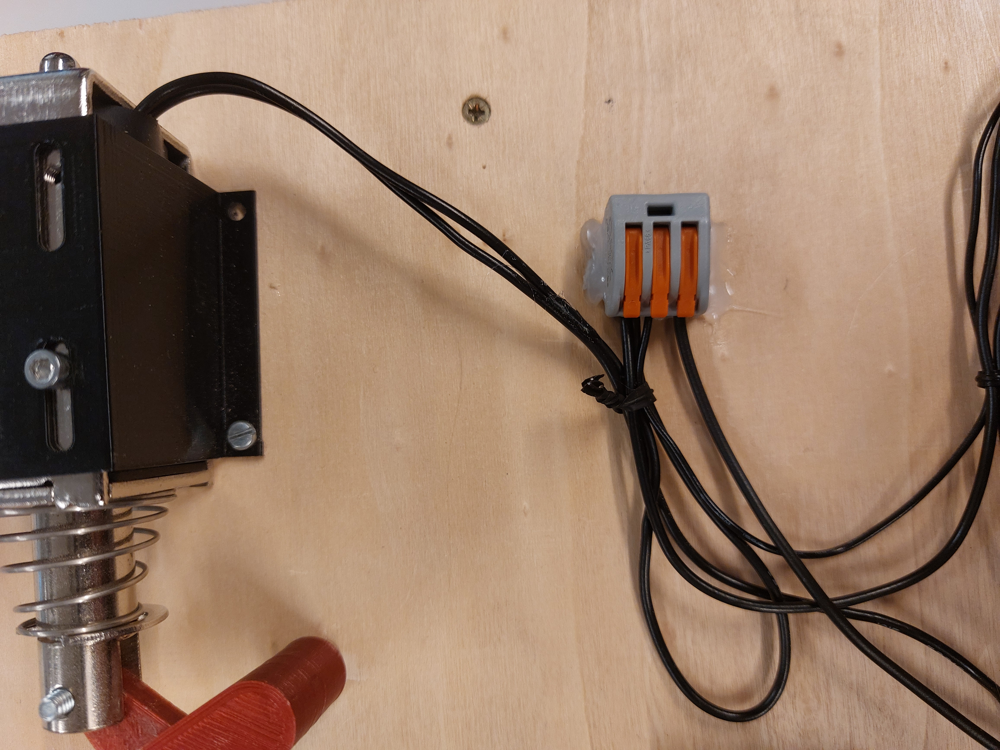

This avoids spending time soldering and makes it easy to unplug a wire if there is a problem.

The other wire of each solenoid is connected to a relay's Normally Open pin, which receives 24V from the power supply when the circuit is closed.

We wrote a small program activating 3 solenoids at the same time to check that everything works correctly.
Then another program to activate the solenoids one by one every second and check that they all work.
We then realized that 2 solenoids were not working correctly. We still need to check their solder joints and wiring.

Finally, I also started adding cable ties to group the wires going through the same place, to get tidier wiring and find our way around more easily.
Here is the underside of the board with the wiring being installed (many wires still have to be connected and the cables better organized):

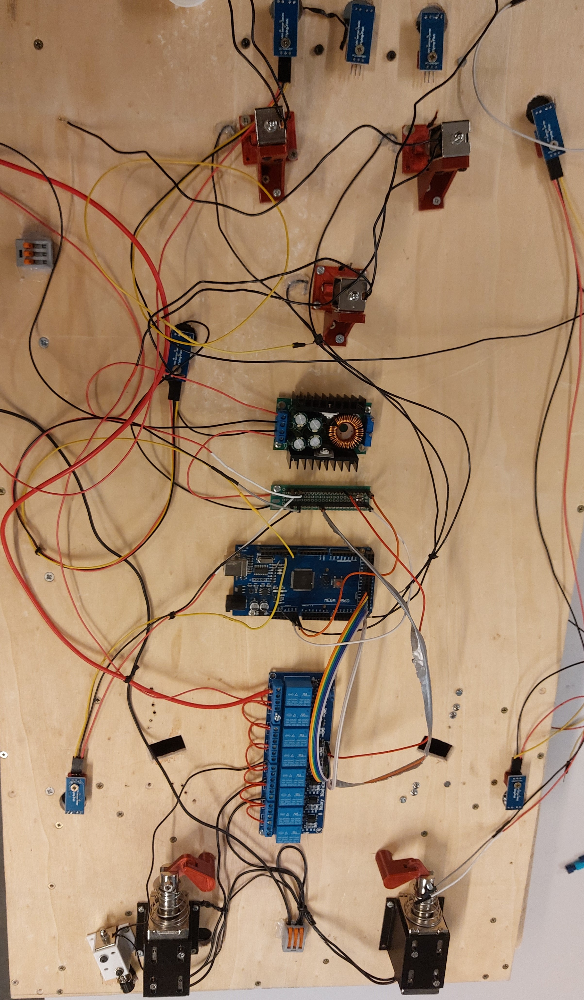

## Final steps to complete

- Finish the wiring by connecting our 8 infrared sensors, the 2 flipper buttons, the 7 microswitches of the slingshots and targets, the screen and the wheel of fortune.

- Glue the targets onto the microswitches, assemble them, then fix the holder on the board.

- Fix the screen and the wheel of fortune on the pinball machine.

- Finish the programming: we had already written programs to test each component separately; we now need to write the complete program that runs a whole game automatically.

- Finish building the ramp and place it on the pinball machine.

- Finishing touches and fixing possible bugs.

The rest of the project is described in the [final report](../../final-report.pdf) ([French version](../../french-version/final-report.pdf)).
